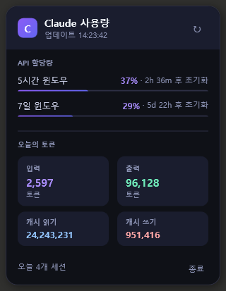

# Claude Usage Tray (Windows)


Windows 시스템 트레이에서 Claude, Codex(ChatGPT), OpenCode, Antigravity AI 사용량과 날씨 알림을 함께 확인하는 통합 모니터링 앱입니다.

> **[claude-usage-mini](https://github.com/jeremy-prt/claude-usage-mini) by [@jeremy-prt](https://github.com/jeremy-prt) 에서 영감을 받았습니다**

## 스크린샷



## 다운로드 (바로 실행)

> **[최신 릴리즈 다운로드 →](https://github.com/jeiel85/claude-usage-tray-windows/releases/latest)**

| 파일 | 크기 | 설명 |
|------|------|------|
| `ClaudeUsageTray.exe` | 약 32 MB | Framework-dependent 단일 실행 파일 — [.NET 9.0 Desktop Runtime](https://dotnet.microsoft.com/download/dotnet/9.0/runtime) 필요 |

**실행 방법:**
1. 위 링크에서 `ClaudeUsageTray.exe` 다운로드
2. 실행 (Windows Defender 경고 → **추가 정보 → 실행**)
3. 시스템 트레이 아이콘 클릭으로 사용량 확인

## 요구 사항

- Windows 10 이상
- [Claude Code](https://claude.ai/code) 설치 및 로그인 상태
- [**.NET 9.0 Desktop Runtime**](https://dotnet.microsoft.com/download/dotnet/9.0/runtime) — 미설치 시 앱이 실행되지 않음

## 공개 링크

- **GitHub Pages**: [jeiel85.github.io/claude-usage-tray-windows](https://jeiel85.github.io/claude-usage-tray-windows/)
- **최신 릴리즈**: [GitHub Releases latest](https://github.com/jeiel85/claude-usage-tray-windows/releases/latest)
- **변경 이력**: [CHANGELOG.md](CHANGELOG.md)

## 이슈
- `버그` Codex·OpenCode 사용량 파서: 숫자가 아닌 JSON 값 하나로 응답·로그 줄 전체가 버려짐 · auth.json 읽기 공유 모드 (#201, 2026-10-13): `JsonElement.TryGetInt64`/`TryGetInt32`/`TryGetDecimal` 은 값이 숫자가 아니면(`null`·문자열) false 가 아니라 예외를 던지는데, Codex 의 Direct API 창(`reset_at`·`limit_window_seconds`)·세션 로그 창(`resets_at`·`window_minutes`)·토큰 합계(`ReadLong`, 주석도 사실과 반대)와 OpenCode 의 `tokens`·`cost` 가 종류를 보지 않고 불렀다. 그래서 API 응답의 아무 창(추가 한도 포함)에 `"reset_at": null` 하나만 와도 API 결과가 통째로 버려져 로컬 로그로 폴백했고, 로그는 그 줄 전체, OpenCode 는 그 행의 토큰·비용이 빠졌다. 목표: ① 숫자일 때만 읽는 헬퍼로 통일해 그 필드만 "값 없음"으로 보고 나머지 창·필드는 정상으로 읽는다. 토큰 합계는 세션 누적값의 차분으로 세므로, `total_token_usage` 자체가 객체가 아니면 지금처럼 그 줄 합계를 쓰지 않고, 필드 하나만 숫자가 아니면 그 필드는 직전 값을 이어 받아 증가 0 으로 둔다(0 으로 읽으면 기준이 0 으로 떨어져 1000 → null → 1500 이 2500 으로 세어진다 — Codex 리뷰봇 P2). ② `~/.codex/auth.json` 을 `File.ReadAllText`(`FileShare.Read`)로 읽던 `TryReadPlanTypeFromAuth`·`TryGetApiCredentials` 를 `TryReadAccountIdentity` 와 같은 읽기 헬퍼로 묶고 `FileShare.ReadWrite | FileShare.Delete` 로 연다 — 읽는 순간 Codex 의 토큰 저장·로그아웃 삭제를 막지 않게. 앱은 여전히 auth.json 에 쓰지 않는다. v1.48.1 로그인 만료 안내 로직은 범위 밖.
- `버그` Codex Direct API 인증 실패(401/403) 시 원인 없이 로컬 로그로 폴백 — 인증 만료 안내 표시 (#198, 2026-10-13): `~/.codex/auth.json` 의 access_token 이 만료되고 Codex 앱 자체도 refresh 에 실패한 PC 에서 `chatgpt.com/backend-api/wham/usage` 가 401 을 줬는데, `FetchUsageFromApiAsync` 가 비성공 응답·예외를 전부 null 로 삼키고 로컬 세션 로그로 조용히 폴백했다. 로그 값은 그 PC 에서 Codex 를 써야 생기므로 기본 게이지가 옛 값·빈 값이 되고, API 응답에서만 오는 모델별 추가 한도(Spark 등)가 아무 설명 없이 사라지며 출처만 "Local Log" 로 바뀌었다. 목표: ① API 실패 사유를 자격 파일·토큰 없음 / 인증 실패 / 그 밖의 HTTP 오류·네트워크 실패로 나눈다 — 401 은 인증 실패, 403 은 Cloudflare 챌린지·차단(1020)·계정 헤더 누락 등 원인이 여럿이라 access_token JWT 의 `exp` 가 이미 지났을 때만 인증 실패로 본다(서명 검증 없이 payload 만 읽음). ② 인증 실패일 때만 Codex 상세에 회색 안내 한 줄("이 PC 의 Codex 로그인이 만료됐습니다…")을 띄운다 — 게이지 출처는 단정하지 않고(동기화로 다른 PC 값일 수 있음), 빨간 오류로 만들지 않으며, 일시적 네트워크 실패에는 띄우지 않고, 예외 경로에서는 안내를 지운다. 4개 언어. 함께 `CodexNoUsageToday` 일본어 문구의 한글 혼입("本지의")을 고치고, ja·zh 의 모든 `Loc` 문자열 속성에 한글이 없음을 검사하는 테스트를 더했다. ③ 앱은 refresh_token 으로 토큰을 갱신하거나 auth.json 에 쓰지 않는다(refresh token 회전으로 Codex 자체가 로그아웃될 수 있음). 참고: 이미지 생성은 별도 한도가 아니라 일반 5시간·주간 한도를 함께 쓴다(공식 Codex 요금 문서) — 이 작업과 무관.
- `기능` OpenCode 요금제(Go Plus)·한도 도달·추가 사용/크레딧·구독 상태 표시 (#196, 2026-10-12): #188 로 읽기 시작한 새 콘솔 `GET /console/api/go/status` 응답에는 할당량 창 말고도 요금제·구독 상태·추가 사용 설정이 들어 있는데 앱은 쓰지 않았다 — 배지는 auth.json 항목 키(`opencode-go`)만 봐서 한도가 4배인 Go Plus 를 구분하지 못했고, 창을 다 써도 게이지만 100% 로 찰 뿐 언제 다시 쓸 수 있는지·크레딧으로 이어 쓰는지 알 수 없었으며, 일시정지·결제 실패 계정에는 "Go 할당량을 찾지 못했습니다" 만 나왔다. 표시 규칙은 콘솔 공개 번들(2026-10-12 `/console/assets/app-pages-*.js`·`index-*.js`)에서 그대로 옮겼다. ① 배지: `product` 가 `go-plus` 면 "OpenCode Go Plus", 콘솔 값을 못 읽으면 종전 auth.json 기준. ② 한도 도달: `resetsAt` 이 있고 `used >= limit` 인 창 가운데 가장 늦게 풀리는 창으로 "주간 한도 도달 · 3d 4h 후 재개"(추가 사용이 켜져 있으면 "… 동안 크레딧으로 계속 사용", 해지 예정 계정의 월간 창이면 "… 후 Go 종료" — 콘솔 배너와 같은 세 갈래). 남은 시간 표기는 초기화 라벨과 같고 절대 시각 토글도 따른다. ③ 추가 사용·크레딧: 콘솔과 같이 크레딧은 관리자만 본다 — `GET /console/api/orgs/current`(+`x-org-id`)의 `role` 이 admin·owner 일 때만 `GET /console/api/billing/status` 를 불러 `availableMicroCents`(결제 화면의 "Available credits", ÷1억 = USD)를 쓰고, 추가 사용은 `useBalance && (멤버 || 크레딧 > 0)` 일 때 켜짐으로 본다(역할을 모르면 콘솔처럼 멤버, 관리자인데 결제 정보를 못 읽으면 콘솔처럼 크레딧 0). 두 조회는 덧붙이는 정보라 실패·401 이어도 할당량·로그아웃 판정에 영향이 없다. ④ 구독 상태(콘솔 Go 카드 상태 칩 순서): 할당량이 있으면 `renewalRetryAt` → 결제 실패(경고색), `renewalAuthorizationRequired` → 결제 조치 필요(경고색), `cancelAtPeriodEnd` → "Go 구독 MM/dd 종료", Go Plus 인데 갱신 상품이 Go → "MM/dd 부터 Go 로 전환". `access: null` 이면 `renewalPaymentAttemptID`(대문자 ID — 이전 조사 노트의 `…AttemptId` 는 오기) → 결제 승인 대기, `renewalPending` → 갱신 처리 중, `renewalAuthorizationRequired` → 재승인 필요, 그 밖 → 일시정지를 #188 리뷰 반영의 `NoQuota` 안내 자리(로그인 버튼 아래)에 보여주고 재시도 대기 중·언어 변경 후에도 유지한다. 해지된 채 기간이 끝난 구독(`access: null` + `cancelAtPeriodEnd`)은 콘솔도 카드를 감추므로 미구독과 같이 본다. 다중 PC 동기화 스냅샷의 `openCode` 에 `product`·`extraUsageEnabled`·`creditsUsd`·`subscription`(이름 문자열 — 모르는 이름·숫자는 정상 갱신으로 봄)·`periodEndsAt` 을 더했다(필드 추가라 스키마 버전 유지). 팝업 게이지 패널은 게이지 3개 구조를 그대로 두고 그 아래 형제 패널에 세 줄을 두며, 빈 줄은 접힌다. 한계: Go 구독 계정이 없어 로그인 상태의 실응답으로는 확인하지 못했다(스키마·판정 순서는 번들 기준 단위 테스트로 고정). #196
- `기능` Antigravity 기본 화면을 Gemini 한도만으로 · Claude·GPT 표시 설정 · 이미지 생성 한도 조사 (#194, 2026-10-12): Antigravity 상세가 Gemini·Claude/GPT × 5시간·주간 4줄을 늘 보여 줘, Gemini 만 쓰는 사용자에게 읽을 것이 많았다. 설정 > 트레이 > 표시 옵션에 "Antigravity 의 Claude·GPT 한도도 표시"(기본 꺼짐, 4개 언어)를 두고, 꺼져 있으면 `3p` 그룹 창을 팝업 행뿐 아니라 트레이 대표값(가장 많이 쓴 창)과 자동 모드 판정(5시간 창 사용 여부)에서도 뺀다 — 숨긴 창이 숫자에 남으면 팝업과 트레이가 어긋난다. 거르는 곳은 `AntigravityViewModel.ApplyQuota` 한 곳이라 다른 PC 에서 받은 값도 같이 걸러지고, 동기화 스냅샷에는 전체를 그대로 올린다. 토글은 다시 조회하지 않고 즉시 반영하며, 이때 다른 PC 값 위에 살려 둔 로컬 오류·크레딧이 지워지지 않도록 행 생성(`RebuildRows`)을 상태 초기화와 분리했다(언어 변경 경로도 같은 함수를 쓴다). 설정 키 `ShowAntigravityThirdPartyQuota` 는 예전 파일에 없으면 꺼짐으로 읽혀 이관이 필요 없다. 꺼 두면 Antigravity 에서 Claude·GPT 를 써서 그 한도가 차도 앱에서 보이지 않는다(사용자 선택). 이미지 생성 한도는 커뮤니티에서 "Gemini 3.1 Flash Image 5시간당 약 6–7장" 이 보고되지만, `retrieveUserQuotaSummary` 실제 캡처(yapcap Pro·무료, cortexkit, 이 저장소 픽스처)에는 4개 버킷뿐이고, GitHub 의 `gemini-image-5h` 는 모두 "미래 버킷" 합성 테스트 값이며, `fetchAvailableModels` 이미지 모델 할당량의 실제 캡처도 찾지 못해 표시할 값을 지어내지 않았다. 대신 버킷 이름을 그룹 키(`그룹-창` 의 앞부분) 정확 비교로 바꿔 `gemini` 로 시작하는 새 그룹이 "Gemini 모델" 칸과 같은 이름으로 불리지 않게 하고, 그룹 키에 `image` 가 들어 있으면 "이미지 생성 · 창"(#182 Codex 와 같은 규칙)으로 부른다 — 그런 버킷이 실제로 오면 추가 수정 없이 한 줄로 나타난다. 진단 도구 `test-antigravity --raw` 가 요약·`loadCodeAssist`(tier·크레딧)·`fetchAvailableModels`(quotaInfo) 원문을 개인 정보 없이 출력해, Antigravity 로그인 PC 에서 실제 필드를 확인할 수 있다. #194
- `버그` OpenCode Go 공식 할당량 조회가 새 콘솔 이전(`/console`)으로 깨짐 (#188, 2026-10-12): upstream `anomalyco/opencode` 커밋 `fe51b0b19`(#50716, 2026-09-22)부터 레거시 `/workspace/<id>/go` 페이지는 첫 줄에서 `throw redirect("/console/go")` 로 무조건 새 콘솔로 보내고, 레거시 콘솔·로그인 콜백은 Black 구독 계정만 받아 나머지는 `/console/login` 으로 보낸다(`billing.ts`: "Go subscriptions have moved to the new Console"). 운영 반영도 확인했다 — `opencode.ai/go` 의 구독 링크가 `https://opencode.ai/console/go` 로 바뀌었고, `/console/api/orgs`·`/console/api/go/status` 가 비로그인 시 `401 {"_tag":"Unauthorized"}` 로 답한다. 앱은 `/workspace/<id>(/go)` 주소만 받아들이고 페이지 HTML 의 `rollingUsage:$R[..]` 를 긁었는데 새 콘솔은 빈 SPA 셸이라, 로그인해도 성공으로 판정되지 않고 자동 조회는 "할당량을 찾지 못했습니다" 로 끝났다(이 PC 의 앱 WebView2 는 8/10 이후 로그인된 적이 없어 로그인 상태의 실응답은 재현하지 못했고, 근거는 upstream 소스·운영 응답·콘솔 공개 번들이다). 콘솔 공개 번들(`/console/assets/*.js`)에서 계약을 읽어 새 콘솔 JSON API 로 같은 세 창을 읽는다: `GET /console/api/orgs` → `[{id,name,avatarUrl}]`, `GET /console/api/go/status` + `x-org-id` → `null` 또는 `{access: null | {endsAt, meters: {fiveHour, week, month}}}`(각 창 `limitMicroCents`·`usedMicroCents` 는 문자열 bigint). 사용률은 콘솔 화면과 같이 `used / limit` 이고, 롤링 창은 첫 사용부터 시작해 시작 전이면 `resetsAt: null` 이 오므로 레거시 서버가 같은 상황에 주던 값(0%, 5시간 뒤)으로 맞추며, 월간 초기화가 빠지면 구독 기간 끝(`endsAt`)을 쓴다. 쿠키를 앱 밖으로 내보내지 않도록 앱 전용 WebView2 의 opencode.ai 문서 안에서 `fetch` 하고 결과를 웹 메시지로 받는다(auth.json 의 키 값은 여전히 읽지 않는다). 콘솔 SPA 는 비로그인 시 `window.location.replace("/login?next=...")` 로 문서를 갈아치우므로, 자동 조회는 스크립트 없는 `/console/api/orgs` 문서에서 하고 로그인 창은 `/console/go` 를 보여주며 2초마다 확인한다(GitHub·Google 같은 로그인 공급자 페이지에서는 확인하지 않는다). 로그아웃 판정은 콘솔 API 의 401 로만 하고, 응답 코드조차 없는 탐색 실패는 종전처럼 확인 실패(짧은 재시도)로 다룬다(#130). 성공한 작업공간 ID 를 `console-org.txt` 에 저장해 다음 조회에서 먼저 쓰고, 그 작업공간이 Go 를 잃었으면 목록에서 다시 찾는다(#126 의 경로 저장 역할). 레거시 `workspace-route.txt` 는 새 콘솔 세션의 증거가 아니므로 "이 PC 에서 된 적 있다" 판정에 쓰지 않는다. 로그인은 됐지만 Go 할당량이 없으면(미구독·일시정지) 그 이유를 4개 언어로 알리고, 접근 정보는 있는데 창을 못 읽으면 응답 형식이 바뀐 것으로 따로 남긴다. 실측(임시 프로필·운영 사이트): 자동 조회 401 → 로그아웃 판정 2.3초, 저장 작업공간 `x-org-id` 조회 401 → 로그아웃 판정, 로그인 창 `/console/go` → `/console/login` 전환 중 오류 없음. 대안인 공식 Go API `GET /zen/go/v1/usage`(Go API 키 Bearer)는 auth.json 키 값을 읽어야 해 정책 변경이 필요하므로 보류했다. 자체 리뷰 반영: 저장된 작업공간의 401 은 그 작업공간에서 빠졌거나 다른 계정으로 로그인한 경우일 수 있어, 로그아웃은 작업공간 헤더 없이 부르는 목록(`/orgs`)의 401 로만 판정하고 나머지는 목록에서 다시 찾는다(저장 작업공간의 응답 없음·5xx 는 목록을 받은 뒤 한 번 더 묻는다). 문서 교체 중 `ExecuteScriptAsync` 가 한 번 거절돼도 로그인 창이 닫히지 않게 응답 없음으로 돌려 다음 확인에서 다시 보고, 앱 종료(Dispose)로 취소된 조회가 닫힌 창·해제된 잠금을 건드리지 않게 했다. 주간·월간 `resetsAt` 은 번들 스키마상 null 이 불가해 대체값을 두지 않았다(롤링만 `NullOr`). Codex 리뷰봇 지적(P2): 예전에 연결했던 PC(저장 작업공간 있음)에서 구독이 해지·일시정지되면 "Go 할당량 없음" 이 일반 확인 실패로 바뀌어 "곧 다시 시도" 안내 뒤로 이유가 숨었다 — 세션 상태에 `NoQuota` 를 따로 두어 로그인 버튼(다른 계정으로 바꿀 길) 아래에 이유를 보여주고, 사용자가 구독·계정 전환을 하기 전엔 결과가 같으므로 로그아웃처럼 30분 간격으로 다시 본다. #188
- `버그` 테스트가 실제 사용자 설정·히스토리 파일을 덮어씀 — 통합 테스트 격리 (#186, 2026-10-12): `SettingsService` 의 경로가 `~/.claude/claude-usage-tray.json` 으로 고정돼 있고 `MainViewModelIntegrationTests` 가 실제 서비스를 그대로 써서, `dotnet test` 를 돌릴 때마다 개발자 PC 의 실제 설정 파일을 다시 썼다(v1.43.0(#183) 작업 중 테스트 한 번으로 사용자 설정이 새 형식으로 이관되면서 확인). 같은 테스트가 `RefreshAsync` 로 실제 히스토리(`~/.claude/claude-usage-tray-history-*.json`)를 기록했고, Claude 토큰이 만료된 시점이면 토큰을 갱신해 `~/.claude/.credentials.json` 까지 다시 쓸 수 있었으며, 실제 설정에 다중 PC 동기화가 켜져 있으면 공유 폴더에 스냅샷을 써 다른 PC 에도 영향을 줄 수 있었다. 더 큰 원인은 WPF 테스트 호스트(`WpfTestHost`)였다 — 리소스를 쓰려고 `new App()` 을 만드는데, WPF 는 `Application` 생성자에서 Startup 을 디스패처에 올려 두므로 `Run()` 없이도 `App.OnStartup` 이 실행돼, 테스트 프로세스 안에서 실제 설정·자격 증명·히스토리·OpenCode 웹 세션을 쓰는 트레이 앱이 통째로 떠서 새로고침·날씨 알림·시작 업데이트 확인까지 돌았다(테스트 실행 중 실제 history·날씨 캐시·`%APPDATA%\ClaudeUsageTray\OpenCodeWebSession` 이 바뀌는 것으로 확인). `SettingsService`·`HistoryService` 에 경로 주입점(선택 인자, 기본값은 지금 경로)을 추가하고, 통합 테스트는 테스트마다 임시 폴더의 설정·히스토리·동기화·자격 파일을 쓰고 끝나면 지운다. `App` 에는 리소스만 올리고 트레이 앱은 띄우지 않는 internal 생성자(`App(startsTrayApp: false)`)를 두고 테스트 호스트가 그것을 쓴다(기본 생성자는 그대로). 앱 동작 변화는 없다.
- `기능` Claude 모델 한정 주간 한도(Sonnet · Fable 등) 게이지 표시 (#187, 2026-10-12): Claude 사용량 API(`/api/oauth/usage`)는 5시간·7일 말고도 특정 모델에만 걸리는 주간 한도를 주는데 앱은 보여주지 않았다 — 최상위 `seven_day_opus`/`seven_day_sonnet` 은 파싱해 `OpusPercent`/`SonnetPercent` 에 넣고도 어디에도 바인딩하지 않는 죽은 값이었고, 최상위 `limits[]` 는 아예 읽지 않았다. `limits[]` 항목은 `{kind(session / weekly_all / weekly_scoped), group(session / weekly), percent(0~100), resets_at, scope.model.{id, display_name}, is_active}` 이고 프로모션 모델(Fable 등) 같은 모델 한정 한도는 이 배열에만 온다 — 공개 클라이언트 두 곳(steipete/CodexBar `ClaudeOAuthUsageFetcher.swift`·`ClaudeScopedWeeklyLimitMapper.swift`, jens-duttke/usage-monitor-for-claude `docs/api-reference.md`·`api.py`)의 실측 예시와 코드로 필드명·의미를 교차 확인했다(이 PC 의 Claude 토큰은 2026-10-01 만료라 실응답은 미확인). 새 `ClaudeModelLimits` 가 모델 범위(`scope.model.display_name`)가 있는 항목만 골라 창 길이를 `group` 으로 정하고(weekly → 7일, session → 5시간, `group` 이 없으면 `kind` 앞부분 `weekly_`/`session_` 으로, 그래도 모르면 창을 지어내지 않음), 기본 게이지와 같은 `session`/`weekly_all` 과 "All models" 범위는 뺀다. `is_active` 는 거르지 않는다 — CodexBar 가 "실제로 걸리는 모델 한도도 false 로 온다"고 실측을 남겼다. Opus/Sonnet 옛 필드는 지우지 않고 같은 목록에 합쳤다: 2026-09 실측 응답에서 `seven_day_sonnet`(2%)이 `limits[]` 에 대응 항목 없이 옛 필드로만 왔으므로 둘은 중복이 아니라 서로를 보완한다. 같은 모델이 양쪽에 다 오면 서버 표시 이름이 있는 `limits[]` 쪽 하나만 쓰고, 표시 이름이 "Sonnet 4.6"·"Claude Sonnet" 이어도 단어 단위로 같은 모델로 본다(창 길이를 모르는 `limits[]` 항목이어도 같은 모델이면 같은 한도로 봐 두 줄로 그리지 않는다 — 자체 리뷰 지적). 쓰지 않던 `OpusPercent`/`SonnetPercent`/`OpusTokens`/`SonnetTokens`(토큰 값은 사용률을 정수로 자른 엉뚱한 값이었다)는 지웠다. `limits[]` 는 문서화되지 않은 필드라 타입으로 묶지 않고 `JsonElement` 로 받아 관대하게 읽는다 — 모양이 바뀌어도 그 항목만 버리고 기본 5시간·7일 조회는 깨지지 않는다(숫자를 문자열로 보내도 읽음). 읽다가 예상 못 한 예외가 나도 모델 한도만 빈 목록으로 내려놓아 기본 게이지·동기화가 함께 실패하지 않게 했다. 동기화 파일의 이름이 비어 있으면 " · 주간" 대신 한도 ID 로 부른다. Claude 상세의 7일 게이지 아래에 창마다 게이지(이름 · 사용률 · 리셋 · 시간선 · 요약, Claude 색)를 붙이고, 행 이름은 서버 표시 이름 + `Loc.QuotaWindowShortName`("Fable · 주간"). 행 생성은 Codex 추가 한도의 규칙을 `QuotaGaugeRow.BuildRows` 로 옮겨 함께 쓰고(한도 이름을 부르는 법만 공급자가 정함), 리셋이 지난 창은 다음 조회를 기다리지 않고 바로 빼며, 계정이 바뀌면 이전 계정의 행을 비운다. 다중 PC 동기화는 Codex 추가 한도와 같은 `AdditionalQuotas` 필드를 재사용한다(모양이 같고 필드 추가라 스키마 버전 유지) — Claude 는 기본 창과 모델 한도가 한 번의 조회로 함께 오므로 Codex 처럼 출처를 따로 고르지 않고, 다른 PC 의 스냅샷을 쓸 때 그 스냅샷의 모델 한도를 그대로 쓴다(필드가 없던 구버전 스냅샷이면 비움). 트레이 대표값과 사용량 알림은 기존 5시간 기준을 유지한다. #187
- `기능` Antigravity Google AI 크레딧 잔액 표시 · disabled/비율 없는 버킷 오표시 수정 (#190, 2026-10-12): Antigravity 의 두 응답에서 앱이 쓰지 않던 값과 파싱 허점을 응답 스키마(바이너리에서 추출된 proto — AntonIXO/antigravity-claude-proxy-go 의 `prediction_service.proto`·`onboarding.proto`·`credits.proto`)와 Google 공개 클라이언트 gemini-cli 소스, 같은 엔드포인트를 쓰는 다른 클라이언트·실제 캡처로 교차 확인했다. ① `loadCodeAssist` 의 `paidTier.availableCredits[]`(`creditType`·`creditAmount`(int64 → JSON 문자열)) 를 읽지 않아, 한도를 다 쓴 뒤 크레딧으로 이어 쓰는 AI Pro·Ultra 사용자가 잔액을 볼 수 없었다 — gemini-cli `getG1CreditBalance` 와 같은 규칙(GOOGLE_ONE_AI 만 합산, 항목이 없으면 대상 아님, 0 도 값)으로 읽어 Antigravity 상세 게이지 아래에 `Google AI 크레딧 · 1,234` 한 줄(4개 언어, 툴팁)로 보여주고, 대상이 아니면 줄을 접는다. `currentTier` 쪽은 같은 잔액을 두 번 셀 수 있어 읽지 않는다(gemini-cli 와 다른 클라이언트도 `paidTier` 만 읽는다). 다중 PC 동기화 스냅샷에 `AiCredits` 를 실었다(필드 추가라 스키마 버전 유지, 구버전 스냅샷은 줄을 그리지 않음). ② `retrieveUserQuotaSummary` 버킷의 잔여량은 `oneof remaining { remaining_fraction, remaining_amount }` 인데, 앱은 `remainingFraction` 이 없으면 1.0(사용 0%)으로 봐서 수량형·값 없는 버킷을 "하나도 안 씀"으로 그렸다 — 한도를 모르는 수량은 사용률로 바꿀 수 없으므로 행을 만들지 않는다(gemini-cli 도 같은 oneof 의 `retrieveUserQuota` 에서 비율 없는 버킷을 건너뛰고, OpenUsage·tokscale 등도 같다). 소진은 `remainingFraction: 0` 으로 명시되므로 0 은 그대로 표시한다. ③ `disabled: true` 버킷(그 tier 가 계량하지 않는 창)도 `remainingFraction: 1` 을 달고 와 "0% 사용" 게이지로 그려졌다 — 실제 사례(stablyai/orca#22511: `gemini-weekly` 소진, `gemini-5h` disabled)에서는 막힌 상황에 5시간 창이 비어 보인다. CodexBar·orca·t3code 등 9개 클라이언트처럼 건너뛴다. ④ 응답 최상위의 그룹 밖 `buckets[]` 도 proto 에 있어, 다른 클라이언트들처럼 `groups` 에서 행을 못 얻었을 때만 대체로 읽는다(실응답에서 채워진 사례는 없음). ⑤ `resetTime` 없는 버킷 숨김은 실제 캡처에서 쓰지 않은 버킷도 `resetTime` 을 가져 문제가 아니므로 그대로 둔다. `loadCodeAssist` 의 tier 가 객체가 아니어도 예외 없이 빈 값으로 넘어가게 했다(배지·크레딧이 게이지를 막지 않도록). 진단 도구 `test-antigravity` 가 크레딧도 출력한다. 한계: 이 PC 에는 `gemini:antigravity` 자격 증명이 없어 실응답으로 확인하지 못했고, 크레딧이 든 실제 캡처도 공개 자료에서 찾지 못했다(스키마·공식 클라이언트 코드 기준). #190
- `기능` Codex 추가 한도(이미지 생성 등) 게이지 표시 (#182, 2026-10-12): Codex 사용량에는 5시간·주간 창 말고도 이미지 생성 같은 별도 한도가 있는데, 앱은 `wham/usage` 응답의 `rate_limit.primary_window`/`secondary_window` 만 읽어 보여주지 않았다. 응답 최상위의 `additional_rate_limits: [{limit_name, metered_feature, rate_limit}]`(openai/codex `codex-backend-openapi-models` 의 `AdditionalRateLimitDetails`, `rate_limit` 은 기본 한도와 같은 창 구조)를 읽어 Codex 상세의 기본 창 아래에 창마다 게이지(이름 · 사용률 · 리셋 · 시간선 · 요약)를 붙인다. 공식 CLI(`backend-client/src/client.rs`)처럼 `metered_feature` 를 한도 ID, `limit_name` 을 표시 이름으로 쓴다. 이미지 생성 한도의 실제 식별자는 공개 자료로 확인되지 않아(이 PC 의 Codex 토큰도 만료돼 실응답은 401) 이름으로 골라내지 않고 추가 한도를 전부 표시하며, ID·이름에 `image` 가 들어 있으면 "이미지 생성"(4개 언어)으로, 모르는 한도는 서버 이름을 다듬어(`gpt-5.3-codex-spark` → `GPT-5.3-Codex-Spark`) 부른다. 기본 한도(`codex`)가 다시 실려 오면 중복으로 그리지 않고, 리셋이 지난 창은 버린다. 세션 로그도 최신 CLI 는 한도마다 `rate_limits` 줄을 따로 남기고 `limit_id` 로 구분하는데(`protocol.rs` `RateLimitSnapshot`), 로그 경로는 이 값을 보지 않고 가장 늦은 줄을 기본 게이지에 넣어 추가 한도 줄이 5시간 창을 덮어쓸 수 있었다 — `limit_id` 가 없거나 `codex` 인 줄만 기본 게이지에 쓰고 나머지는 한도별 최신 줄을 추가 한도로 모은다(`rate_limits: null` 줄은 건너뛰고, 리셋 시각이 없는 추가 한도 창은 지금 창인지 가릴 수 없어 버리며, 창이 남지 않는 줄은 앞서 읽은 값을 지우지 않는다). 다중 PC 동기화 스냅샷에 추가 한도를 창별 관측 시각과 함께 실어(필드 추가라 스키마 버전 유지), 토큰이 만료돼 로그로만 읽는 PC 도 다른 PC 가 본 값을 쓴다 — 이 PC 로그 값과 동기화 폴더의 모든 스냅샷 값을 모아 한도마다 가장 최근에 관측된 출처를 고른다. 기본 창용 할당량 후보(`SelectQuotaCandidates`)는 가장 최근 스냅샷 하나만 고르는데 방금 쓴 이 PC 스냅샷이 거의 항상 뽑혀 다른 PC 의 추가 한도가 버려지므로 쓰지 않는다(자체 리뷰 지적). 단 이 PC 가 Direct API 로 읽었으면 비어 있어도 그 값이 정답이다(다른 PC 의 옛 값으로 이미 없어진 한도를 되살리지 않는다). 공유 폴더의 추가 한도 목록·요소·문자열이 null 이어도 읽을 때 보정하고, 표시 중인 창은 리셋이 지나면 다음 조회를 기다리지 않고 바로 뺀다. 게이지 행은 Antigravity 의 `AntigravityModelRow` 를 범용 `QuotaGaugeRow`(속성 `ModelId` → `Key`)로 옮겨 함께 쓰고, 창 이름("주간 / 5시간")도 분 단위 공용 함수 `Loc.QuotaWindowShortName` 으로 모아 Antigravity 문구는 그대로 유지했다. 트레이 대표값과 사용량 알림은 기본 한도 기준을 유지한다(이미지 한도 소진이 코딩을 막지는 않는다). #182
- `개선` Gemini CLI 설정을 Antigravity 설정으로 통합 — Gemini CLI → Antigravity CLI 전환 반영 (#183, 2026-10-12): Google 이 2026-05-19 Gemini CLI 를 Antigravity CLI 로 전환한다고 발표했고 06-18 부터 개인 계정(Google AI Pro/Ultra·무료)의 Gemini CLI 요청이 중단됐다. 그런데 설정에는 `Gemini CLI` 만 있고 `Antigravity` 는 없었다 — `IsAntigravityEnabled` 가 `true` 고정·미저장이라 섹션을 끌 수 없었고, 트레이 표시 기준으로도 고를 수 없었다(README 는 "트레이 게이지에 가장 많이 소진된 창을 올린다" 고 적었지만 실제로는 선택 불가). Gemini CLI 파서는 `~/.gemini/tmp/*/chats/session-*.jsonl` 을 읽는데 Antigravity CLI 는 세션을 `~/.gemini/antigravity-cli/brain/` 에 다른 형식으로 써서 후속 도구 사용량은 잡히지 않는다. 설정의 표시할 공급자·트레이 표시 기준을 `Antigravity` 로 바꾸고 표시 여부를 `VisibleProviders` 에 저장한다. 트레이 게이지(가장 많이 소진된 창)·상태 문구·트레이 메뉴·툴팁(`AG`)이 Antigravity 를 다루며, 자동 모드에서는 5시간 창 사용률이 0 보다 클 때만 고른다(Codex 와 같은 기준 — 주간 창은 한 번 쓰면 일주일 내내 0 보다 커서 근거로 삼으면 Claude 를 쓰기 전 아침마다 트레이를 빼앗는다). 할당량을 못 받은 상태에서 고정해 두면 0% 대신 "—"/오류 아이콘을 쓴다. 기존 설정은 `NotificationSettings.ProviderSettingsVersion`(없으면 0) 으로 구분해 `SettingsService.Load` 에서 한 번 옮긴다 — `gemini-cli` 를 표시 목록에서 빼고, 예전에 항상 보이던 Antigravity 는 Gemini CLI 체크 여부와 무관하게 표시 목록에 넣으며, `gemini-cli` 로 고정한 트레이 기준·펼친 공급자는 `antigravity` 로 잇는다. 수집 대상이 사라진 Gemini CLI 공급자(`GeminiCliUsageMonitor`·`GeminiViewModel`·팝업 섹션·트레이 메뉴·전용 문자열)는 제거했다.
- `기능` Claude 로그인 만료 시 팝업에서 바로 터미널을 열어 `claude auth login` 실행 — CLI 가 없으면 설치부터 (#180, 2026-10-08): refresh 토큰이 거절(`invalid_grant`)되거나 토큰 파일이 없으면 "터미널에서 claude auth login 으로 다시 로그인하세요" 라는 안내만 떠서, 사용자가 직접 터미널을 열고 명령을 쳐야 했다. 재로그인만이 해결책인 이 두 상태(`ClaudeViewModel.NeedsLogin`)에서 에러 문구 아래에 "터미널에서 로그인" 버튼을 띄운다. 버튼은 `HasError && NeedsLogin` 일 때만 보여, 에러를 지우는 경로가 플래그를 따로 내리지 않아도 남지 않는다. 누르면 `ClaudeLoginLauncher` 가 새 PowerShell 창(`-NoExit`, 결과를 읽을 수 있게 창 유지)에서 `claude auth login` 을 실행한다. 스크립트는 `-EncodedCommand`(UTF-16LE Base64)로 넘겨 한글·공백·작은따옴표가 든 경로도 인용 규칙과 무관하게 전달한다. CLI 경로는 이 프로세스의 PATH(앱 시작 시점에 고정됨)뿐 아니라 레지스트리의 사용자·시스템 PATH, 네이티브 설치 위치(`%USERPROFILE%\.local\bin`), npm 전역 위치(`%APPDATA%\npm`)에서 `claude.exe`→`claude.cmd` 순으로 찾는다. 찾지 못하면 버튼이 "Claude Code 설치 후 로그인" 으로 바뀌고, 공식 문서의 Windows PowerShell 설치 명령(`irm https://claude.ai/install.ps1 | iex`, 관리자 권한 불필요)으로 설치한 뒤 `%USERPROFILE%\.local\bin\claude.exe auth login` 을 실행한다(설치 직후에는 그 세션의 PATH 가 갱신되지 않으므로 전체 경로). 공식 부트스트랩 스크립트는 실패 시 `exit 1` 을 불러 같은 세션에서 돌리면 오류를 읽기 전에 창이 닫히므로, 자식 PowerShell 로 분리해 종료 코드로만 성패를 판단한다(Windows 10 PowerShell 5.1 대비 TLS 1.2 를 켠다). CLI 설치 여부는 로그인이 필요한 동안 새로고침마다 UI 스레드 밖에서 다시 확인해 문구를 맞추고, 실제 분기는 클릭 시점에 다시 찾는다. 로그인이 끝나 자격 파일이 바뀌면 기존 감시자(`CredentialsChanged`)·폴링이 새로고침을 이어받고, refresh 토큰이 바뀌어 #177 의 백오프도 즉시 풀린다. 문구는 4개 언어로 추가했다. 리뷰 반영(Codex 리뷰봇·자체 리뷰): 클릭 시점의 CLI 탐색도 스레드풀로 옮겨 PATH 의 응답 없는 네트워크 경로가 팝업을 멈추지 않게 했고(Codex P2), 실행 뒤 3초간 버튼을 잠가 연타로 창·설치가 겹치지 않게 했다(두 설치가 같은 다운로드 파일을 다툰다). PowerShell 은 곡선 따옴표(U+2018~U+201B)도 작은따옴표로 읽어 `O’Brien` 같은 사용자 폴더에서 문법 오류가 났으므로 함께 이스케이프한다. 앱 시작 때 `~/.claude` 가 없던 PC(설치 후 로그인 대상)는 파일 감시자가 없고, 감시자가 있어도 트레이 공급자가 Claude 가 아니면 즉시 새로고침하지 않으므로, 터미널을 띄운 뒤 최대 15분간 3초마다 자격 파일 수정 시각을 확인해 바뀌면 바로 새로고침한다. 감시자가 있고 트레이 공급자가 Claude 면 `OnCredentialsChanged` 가 먼저 새로고침하며 이 폴링 감시를 취소해, 같은 변경으로 두 번 새로고침하지 않는다(Codex 리뷰봇 2차 지적 — 폴링 쪽은 변경을 본 뒤 2초를 기다려 감시자에게 우선권을 준다). 한계: 시계상 유효한 액세스 토큰이 서버에서 401 로 거절되는 경우(토큰 폐기 등)는 갱신 실패로 분류되지 않아 버튼이 뜨지 않는다. #180
- `버그` Claude 토큰 만료 후 갱신 실패가 백오프 없이 반복돼 토큰 엔드포인트가 429 로 막힘 — 사용량 미확인 상태 고착 (#177, 2026-10-08): Claude 섹션이 "사용량을 아직 확인하지 못했습니다" 에 머물렀다. 실측: `~/.claude/.credentials.json` 의 액세스 토큰이 2026-10-01 08:41 에 만료됐고, 이 PC 는 Claude Code CLI 를 거의 쓰지 않아(데스크톱 앱 사용) CLI 가 대신 갱신해 주지 않았다. `CredentialService.GetValidAccessTokenAsync` 는 매 폴링(2분)마다 refresh 를 시도하고 실패해도 백오프 없이 만료 토큰으로 `/api/oauth/usage` 를 불러(401) 2분 뒤 또 refresh 를 두드렸다 — 7일간 하루 약 720회. 같은 요청을 재현하니 토큰 엔드포인트가 `429 rate_limit_error` 를 돌려줬고, 앱은 이 실패를 삼켜 원인 없이 "아직 확인하지 못했습니다" 와 원문 "OAuth access token has expired" 만 보였다. 갱신이 서버에서 실패하면 5분에서 시작해 연속 실패마다 두 배(상한 60분)로 기다리고, 429 의 `Retry-After` 보다 일찍 재시도하지 않는다(네트워크 오류는 서버에 닿지 않았으므로 1분). 유효한 토큰을 읽거나 갱신에 성공하거나 재로그인으로 파일의 refresh 토큰이 바뀌면 백오프를 즉시 푼다. refresh 요청에 Claude Code(2.1.150)처럼 저장된 `scopes` 를 `scope` 로 싣는다. 만료 토큰으로 401 을 받았고 갱신도 실패했으면 원문 대신 "갱신이 일시 제한됨 · HH:mm 이후 자동 재시도"(429), "갱신 실패 · HH:mm 이후 자동 재시도"(그 밖), "로그인이 만료됨 — claude auth login"(`invalid_grant`) 를 4개 언어로 안내한다. v1.41.15 후속(머지 후 코드 리뷰 지적 4건): scope 를 실은 요청이 400(invalid_grant 아님)으로 거부되면 scope 없이 한 번 더 보내 #177 이전 동작으로 폴백, `Retry-After` 는 6시간 상한(안내가 HH:mm 만 표시해 하루 넘는 대기가 오늘처럼 읽힘), 같은 refresh 토큰이 `invalid_grant` 를 받은 뒤 429 가 와도 재로그인 안내 유지, `scopes` 를 `JsonElement` 로 받아 형식이 달라도 자격 파일 전체 파싱이 실패해 "토큰 없음"이 되지 않게 했다. #177
- `버그` 여러 PC 가 같은 ntfy 토픽으로 같은 알림을 각자 발송함 (#175, 2026-09-30): `NotificationService` 의 "여러 PC 동일 토픽 중복 방지" 검사(`IsRecentDuplicateAsync`)는 본문(title+message)이 같은지 봤는데, 본문에 `— {PC 이름}` 이 붙은 뒤에 비교하고 "N분 후 초기화" 같은 상대 시간 문구도 PC 마다 달라 다른 PC 의 알림과는 절대 일치하지 않았다(검사 창 3분도 슬립에서 깬 PC 를 못 잡음). 본문 비교를 없애고 사건 키(`NtfyEventKey`: 공급자·종류·임계값·서버가 준 창 리셋 시각)를 ntfy `sequence_id` 로 발행한 뒤, 발송 전에 토픽 캐시(`since=12h`)에서 같은 키가 있는지 찾는다. 리셋 시각·예상 소진 시각은 PC 간 오차를 허용(5분·10분)하고, 표시 언어에 따라 달라지는 문구는 키에 쓰지 않는다. 계정이 다른 PC(회사·개인 등)가 같은 토픽을 쓰면 공급자·창·임계값이 같은 알림이 서로를 삼키므로(Codex 리뷰봇 지적), 키에 계정 식별자의 해시 8자리를 넣는다(원문은 공개 토픽 캐시에 남기지 않는다). Codex 는 `auth.json` 의 `tokens.account_id` 와 id_token 의 `chatgpt_user_id`(없으면 `user_id`) — 토큰은 갱신 때마다 바뀌므로 쓰지 않는다 — Claude 는 자격 파일의 `organizationUuid` 다. 계정을 알 수 없으면(API 키 모드처럼 식별자가 없는 로그인, 일시적 읽기 실패) 계정 대신 이 설치의 무작위 기기 ID(`DeviceIdentity`: 처음 한 번 만들어 `~/.claude/claude-usage-tray-device-id` 에 저장하고 재시작해도 유지, 읽기·쓰기가 실패하면 이번 실행에서만 쓰는 임시 ID)의 해시를 넣어, 모르는 쪽끼리 "모름" 이라는 이유로 같은 키가 되어 서로 다른 계정의 알림을 삼키는 일을 막는다(Codex 리뷰봇 2차 지적). 그 PC 는 다른 PC 와 중복이 걸러지지 않을 뿐 알림은 잃지 않고, 같은 PC 의 반복은 재시작 뒤에도 걸러진다. 컴퓨터 이름·사용자 이름은 복제·재설치·같은 이름 설정으로 다른 PC 와 겹칠 수 있어 쓰지 않았다(Codex 리뷰봇 3차 지적). 처음에는 실행마다 새로 뽑는 값으로 충분하다고 봤지만, 레이트 리밋 알림은 오늘 기록에 발생 흔적이 있으면 시작 직후 첫 관측에서도 나가므로 재시작을 넘는 ID 가 필요하다(5차 지적). 한계: `~/.claude` 폴더를 통째로 복제하면 이 파일도 함께 복제되어 두 PC 가 같은 ID 를 갖는다. 그리고 감지 시각으로 대체하는 키(창 리셋 시각을 모르는 경우)는 분 경계를 걸쳐 동시에 감지하면 서로 다른 `sequence_id` 를 발행해 Android·웹에서 합쳐지지 않을 수 있다 — 어떤 시각 내림 방식도 경계는 생기므로 원리적으로 없앨 수 없고, 창의 서버 리셋 시각으로 식별하는 키는 이 문제가 없다(6차 지적). Claude 는 조직 단위 식별자뿐이라, 같은 조직의 서로 다른 사람이 한 토픽을 함께 쓰면 구분하지 못한다. 할당량 초기화 알림의 사건 식별자는 감지 시각이 아니라 "초기화로 끝난 창의 서버 리셋 시각"(`QuotaAlertBaseline` 이 돌려주는 `EndedWindowResetAt`, 추정치면 감지 시각으로 대체)이라, 초기화를 자고 넘겨 30분 넘게 늦게 깬 PC 도 다른 PC 의 같은 알림을 알아본다(Codex 리뷰봇 4차 지적). 발행하는 `sequence_id` 의 시각 조각은 분 단위로 내려, 몇 초 차이로 동시에 감지한 두 PC 가 같은 ID 를 발행해 Android·웹에서 한 알림으로 합쳐지게 한다(비교는 내림 폭 59초만큼 넉넉히 봐서 원래 맞던 짝은 그대로 맞는다). 날씨 알림은 기존 PC 내부 중복 키(위치·날짜 포함)를 그대로 키로 쓰되, PC 의 지역 설정에 따라 키가 달라지지 않도록 `WeatherAlertKeys` 로 InvariantCulture 서식을 쓴다(실측: de-DE/fr-FR/sv-SE 는 좌표가 "37,57", th-TH 는 연도가 불교력, sv-SE 는 음수 부호가 U+2212 — Codex 리뷰봇 3차 지적. en-US·ko-KR 에서는 예전 문자열과 같아 기존 발송 기록이 유효하다). 키의 날짜도 PC 의 "오늘" 이 아니라 예보 자체의 날짜(`DailyWeatherForecast.Date`, 위치의 현지 날짜)이고, 현재 관측으로 판정하는 강풍의 6시간 쿨다운 창은 UTC 기준으로 자른다 — PC 의 로컬 날짜·시각을 쓰면 시간대가 다른 PC 가 다른 날의 알림을 같은 사건으로 착각해 정당한 알림을 삼킨다(도쿄 PC 가 LA 의 9월 29일 예보를 "9월 30일" 키로 보내면 LA PC 의 진짜 9월 30일 예보가 막힘. 강풍 창은 로컬 시각으로 자르면 16시간 떨어진 두 순간이 같은 창으로 찍힘 — Codex 리뷰봇 7차 지적). 강풍 창 경계가 로컬에서 UTC 로 옮겨져, 업데이트 직후 강풍 조건이 이어지고 있으면 알림이 한 번 더 갈 수 있다. 레이트 리밋 알림은 감지 시각이 아니라 세션 로그에 찍힌 기록 시각(`SessionStats.RateLimitAt`)으로 사건을 식별해, 앱을 다시 켜서 같은 기록을 30분 넘게 뒤에 또 읽어도 ntfy 로는 다시 나가지 않는다(Windows 알림 자체는 앱을 켤 때마다 다시 뜰 수 있다 — 기존 동작). 테스트 알림은 키가 없어 항상 발송된다. 실측(2026-09-30, 4회): ntfy.sh 는 발행한 메시지가 폴링에 보이기까지 1.0~1.6초 걸려, 확인 전에 0~4초 무작위 대기를 둔다. 서버가 `sequence_id` 를 거부하면(400) 키 없이 한 번 더 보내 알림을 잃지 않으며, 확인에 실패해도 그냥 보낸다. 한계: 두 PC 가 약 2초 안에 동시에 감지하면 둘 다 보낼 수 있고(Android·웹은 같은 `sequence_id` 를 한 알림으로 합치지만 ntfy 문서상 iOS 는 대상이 아님), 확인 범위는 ntfy 서버 캐시 보존(기본 12시간)까지다. 완전히 없애려면 기존처럼 한 PC 에서만 발송을 켠다.
- `버그` Codex 푸시 알림이 엉뚱하게 발송됨 (#173, 2026-09-30): ① Codex 할당량 초기화 알림이 `Loc.QuotaResetTitle/Body` 의 Claude 고정 문구("Claude 할당량 초기화됨")로 나갔다 → 공급자 이름을 받도록 바꾸고 4개 언어에 반영(Claude 문구는 그대로). ② Codex 는 `{50,75,90,100}` 을 하드코딩해 설정에서 끈 임계값도 발송했다 → Claude(`CheckThresholds`)와 같이 저장된 설정의 임계값만 쓴다. ③ `CodexViewModel` 이 조회 결과가 무엇이든 "이전 값"을 덮어써서, API 실패→로그 폴백(0% 또는 옛 값)이 기준선을 무너뜨렸고 다음 정상 조회에서 50/75/90 이 한꺼번에 재발송되거나 가짜 "초기화" 알림이 나갔다 → 기준선 판정을 `QuotaAlertBaseline` 으로 분리해 창을 설명하는 실제 관측(리셋 시각 존재)으로만 기준선을 움직이고, 같은 창 안에서 값이 내려가는 폴백은 무시하며, 서버가 준 리셋 시각이 지났을 때만 초기화로 본다(로그에 리셋 시각이 없어 추정한 값의 경과는 증거로 쓰지 않는다). 다중 PC 가 각자 발송하는 중복은 범위 밖(아래 "여러 PC 에서 같은 토픽을 쓰는 경우" 안내로 우회).
- `버그` Claude Code 보다 트레이가 먼저 뜬 PC 에서 로그인해도 구독 등급이 고정됨 (2026-09-24): `CredentialService` 는 생성 시점에 `~/.claude` 폴더가 있어야 `FileSystemWatcher` 를 만들고, `UpdateClaudeSubscription` 은 생성 시와 `CredentialsChanged` 에서만 호출돼, 폴더가 없던 PC 에서는 이후 로그인해도 `IsSubscribed`·`ClaudePlanLabel` 이 재시작 전까지 갱신되지 않았다(#152 이후 `IsSubscribed` 가 섹션 표시를 좌우해 영향이 커짐). `RefreshClaudeAsync` 의 orgUuid 폴백 자리에서 매 새로고침마다 구독 상태를 다시 읽고, 파일이 있는데 읽지 못한 경우(쓰기 도중)는 `TryGetSubscriptionInfo` 가 false 를 돌려 직전 값을 유지한다(파일이 없으면 로그아웃으로 확정). 자격 파일 읽기에 `FileShare.ReadWrite` 를 적용했다. 같은 이슈의 정리 항목으로, Gemini 표시 규칙을 `IsGeminiSectionActive` 로 뽑아 네 공급자의 판정 모양을 맞추고, 읽는 곳 없이 기본값 `true` 로 남아 있던 `ProviderUsageSnapshot.IsSubscriptionActive` 를 제거했다 — 이 필드만 알던 "guest 는 무료" 규칙은 실제 판정인 `IsPaidCodexSubscription` 으로 옮겼다. #154
- `개선` 다중 PC 동기화 최후 폴백 하드닝 (2026-09-24): "신선한 값, 없으면 창이 유효한 최후 관측" 선택 규칙이 Claude(out 파라미터+인라인 분기)·Codex/Antigravity(`SelectQuotaWithLastResort`)·OpenCode(`??` + `CreateOpenCodeWebUsage` 내부 검사) 세 가지 모양으로 흩어져 있었고, 신선도용·최후폴백용 조회 쌍도 세 곳에서 따로 짝지어 호출했다. `UsageSyncService.SelectQuotaCandidates`/`IsQuotaWindowStillActive` 하나로 모아 모든 provider 가 같은 규칙을 쓰게 했다(창 판정에 Antigravity 모델별 리셋·OpenCode 세 창도 포함). 공유 폴더가 날짜별로 나뉘어 자정 직후에는 어제 23시대 관측을 통째로 놓치던 문제를, 오늘 폴더에 할당량이 없을 때만 어제 폴더도 읽는 것으로 고쳤다. 최후 폴백이 24시간 전 값까지 쓰는데 출처 캡션이 `HH:mm` 만 적어 어제 값이 방금 값처럼 읽히던 문제는 오늘이 아니면 날짜를 붙이도록 고쳤다. Antigravity 표시를 끈 PC 에서 다른 PC 값으로 섹션이 다시 켜지지 않게 적용 단계에 게이트를 뒀다. Codex 리뷰봇 지적 2건(신선한 값도 리셋 직후면 창 검사로 거를 것, 관측 시각을 지금 오프셋이 아닌 시스템 시간대로 변환할 것 — 서머타임 전환 시 1시간 어긋남)도 같은 PR 에서 반영했다. #160 #158 #171
- `개선` Codex/Gemini CLI 오늘의 토큰 타일 — 빈 타일이 스크롤만 늘림 (2026-09-18): Codex·Gemini CLI 섹션의 "오늘의 토큰" 4타일(입력/출력/캐시읽기/캐시쓰기) 중 캐시 쓰기 타일은 두 공급자 모두 API 특성상 cache write 개념이 없어(`CodexUsageMonitor`는 `TotalCacheWriteTokens += 0` 고정, `GeminiViewModel`은 `CacheWriteLabel = "—"` 고정) 구조적으로 항상 "—"만 표시했다. 4타일(2×2)을 입력/출력/캐시읽기 3타일(1행)로 줄였다. 나머지 3타일도 그날 아직 값이 없으면(`—`) 개별적으로 숨기도록 `StringToVisibilityConverter`에 `ConverterParameter="dash"` 분기를 추가해(기존 `PercentToStarGridLengthConverter`의 `ConverterParameter="inverse"` 관례를 따름), 일부만 비면 그 타일만 접히고 나머지가 왼쪽으로 붙으며(`UniformGrid`가 Collapsed 자식의 슬롯을 건너뛰는 동작은 오프스크린 렌더로 실측 확인) 전부 비면 행 전체가 사라진다. 요금제는 알지만 오늘 로컬 토큰 기록이 없어 세 라벨이 모두 "—"인 날에는 타일 위 구분선도 함께 접히도록 `IsCodexTokenRowVisible` 계산 프로퍼티를 추가했다(자체 리뷰·Codex 리뷰봇 P2 지적으로 발견). #170 #169
- `버그` Antigravity 는 절대 시간 표시 설정을 켜도 라벨에 보이지 않음 (2026-09-18): 설정 > "초기화 절대 시간 표시" 토글을 켜도 Antigravity 상세의 리셋 라벨은 계속 상대 시간만 보여줬다. v1.41.8(#165)에서 `ShowAbsoluteResetTime` 값 자체는 Antigravity 로 전달되게 고쳤지만, 행 이름 잘림 문제(#139) 때문에 라벨에는 여전히 상대 시간만 쓰고 게이지 막대 위에 마우스를 올려야 뜨는 툴팁에만 절대 시각을 추가하도록 남겨둔 게 원인이었다 — 토글을 켜도 눈에 보이는 변화가 없어 사용자 입장에서는 "여전히 안 붙어 있다"였다. `AntigravityViewModel.UpdateTimeProgress` 가 `ResetAtLabel` 생성 시 `showAbsoluteResetTime` 을 그대로 전달하도록 바꿔 Claude·Codex·OpenCode 와 동일하게 라벨에 직접 괄호로 절대 시각이 붙게 했다. 이름 잘림은 같은 커밋(#139)에서 이미 마련해 둔 `TextTrimming="CharacterEllipsis"` + 전체 이름 툴팁으로 그대로 감당한다. 오프스크린 렌더로 실제 레이아웃을 확인해 이름이 잘려도 읽는 데 지장 없음을 검증했다. #167
- `버그` 초기화 절대 시간 표시 설정이 Antigravity·OpenCode 에는 적용되지 않음 (2026-09-18): 설정의 "초기화 절대 시간 표시" 토글이 Claude·Codex 리셋 라벨에는 반영되는데, Antigravity·OpenCode 는 토글과 무관하게 항상 같은 방식으로만 표시됐다(Antigravity 는 행 라벨이 항상 상대 시간뿐이고 툴팁은 항상 절대 시각을 붙였으며, OpenCode 의 Rolling/Weekly/Monthly 라벨은 항상 절대 시각을 붙였다). `AntigravityViewModel`/`OpenCodeViewModel` 이 `UsageCalculator.FormatResetLabel` 호출 시 `showAbsolute` 인자를 하드코딩해 설정값을 아예 받지 않은 게 원인이었다. 두 ViewModel 에 `ShowAbsoluteResetTime` 프로퍼티를 추가해 `MainViewModel` 의 토글 값을 그대로 전달하도록 연결했다. Antigravity 는 행 이름 잘림 문제(#139) 때문에 라벨 자체에는 여전히 절대 시각을 붙이지 않고, 설정이 켜졌을 때만 툴팁에 절대 시각 줄을 추가한다(꺼져 있으면 Claude·Codex 와 마찬가지로 어디에도 절대 시각이 붙지 않는다). OpenCode 는 Claude·Codex 와 동일하게 라벨에 직접 괄호로 절대 시각을 붙이거나 뗀다. #165
- `버그` Codex Direct API 가 존재하지 않는 도메인·잘못된 스키마로 출시 이래 단 한 번도 성공한 적 없음 (2026-09-18): 노트북(Codex 로그인 사용 중)과 회사 데스크톱(Claude 만 사용)에서 같은 계정을 쓸 때 Claude 사용량은 잘 합산되는데 Codex 는 이 PC 로컬 기록만 보여줬다. Claude 의 "합산"은 사실 공식 계정 API 가 서버에서 이미 계정 전체 사용량을 돌려주기 때문이었고, Codex 도 같은 방식(Direct API)으로 설계돼 있었지만 `FetchUsageFromApiAsync` 가 한 번도 성공한 적이 없었다: `UsageApiEndpoint`(`api.openai-v2.com`)가 DNS 에 등록조차 안 된 도메인이었고, `auth.json` 토큰 경로(#148)도 최상위가 아니라 `tokens.access_token` 에 있었으며, 응답 스키마 자체도 로컬 로그와 달리 `rate_limit.primary_window`/`secondary_window`(`limit_window_seconds`·`reset_at`)로 감싸여 있었다(도메인만 고쳐도 스키마가 안 맞아 계속 실패했을 것). 실제 codex CLI(`openai/codex` 저장소)가 쓰는 `chatgpt.com/backend-api/wham/usage` 엔드포인트와 `ChatGPT-Account-Id` 헤더, 실제 응답 스키마에 맞춰 다시 구현했다. #163 #148
- `버그` Codex·OpenCode·Antigravity 는 다중 PC 최후 폴백이 없어 원본 PC 가 잠자기/종료면 게이지가 사라짐 (2026-09-15): Claude 는 공유 동기화 폴더만 제대로 설정돼 있으면 이 PC 에서 전혀 쓰지 않는 provider 도 다른 PC 값을 받아 표시되는데, Codex·OpenCode·Antigravity 는 원본 PC(예: 노트북)가 잠자기·종료 상태로 신선도 기준(기본 5분)만 지나도 다른 PC 에서 게이지가 곧바로 사라졌다. v1.41.4(#156)에서 "당일 관측치면 오래됐어도 창이 아직 유효한 한 최후 폴백으로 쓴다" 로직을 Claude 전용으로만 추가한 게 원인이었다. `IsSyncedQuotaWindowStillActive`(이름만 일반화)와 새 헬퍼 `SelectQuotaWithLastResort` 로 Codex·Antigravity 에도 같은 최후 폴백을 적용하고, OpenCode 는 자체 창 검사를 재사용했다. 8각도 자체 리뷰에서 이 확장이 드러낸 확정 버그 4건(Codex·Antigravity 최후 폴백이 실제 로그인 에러를 최대 24시간 가릴 수 있던 문제, Antigravity·OpenCode 가 이미 리셋된 창의 값을 그대로 보여줄 수 있던 문제)도 같은 PR 에서 수정했다. #161 #159
- `버그` 구독 중이어도 오늘 Codex 를 쓰지 않으면 Codex 섹션이 표시되지 않음 (2026-08-28): ChatGPT Plus 구독 중인데 오늘 Codex 를 쓰지 않은 상태로 앱을 열면 `API 할당량` 목록에서 Codex 만 사라졌다. 섹션 표시 판정이 `5시간 창 사용률 · 오류` 만 봤는데, Codex 의 5시간 창은 초기화 시각이 지나면 통째로 버려지므로(`CodexUsageMonitor.DropExpiredWindows`) 0% 가 되고 `오늘 사용 없음` 은 오류로 치지 않아 둘 다 거짓이 된다. 실측(2026-08-28, DESKTOP-V0JCEPJ): 5시간 0% · 주간 21%(09-02 초기화) · `ChatGPT Plus` 를 손에 들고도 종전 판정은 False. 주간 창 사용률·살아 있는 창 보유·오늘 토큰·유료 구독(`~/.codex/auth.json` id_token 의 `chatgpt_plan_type`)을 표시 근거로 인정하고, 판정식을 `MainViewModel.IsCodexSectionActive` 로 뽑아 회귀 테스트를 붙였다. #150·#152 와 같은 모양의 결함으로 #154 에 후보로 적혀 있던 항목이다. #155
- `버그` 구독 중이어도 그날 첫 사용 전에는 Claude 섹션이 표시되지 않음 (2026-08-26): Claude Max 구독 중인데 그날 아직 Claude 를 쓰지 않은 상태로 앱을 열면 `API 할당량` 목록에서 Claude 만 사라졌다. 섹션 표시 판정이 `오늘 토큰 · 5시간 창 사용률 · 오류` 만 봐서, 첫 사용 전에는 셋 다 0 이라 `데이터 없는 공급자 자동 숨김`(기본 ON)과 맞물려 이미 받아 둔 게이지(실측 5시간 2% · 7일 70%)와 `Claude Max 5x` 배지를 손에 들고도 통째로 Collapsed 됐다. `UpdateClaudeSubscription` 이 채우던 `ClaudeVm.IsSubscribed` 는 주석에 "0% 사용이어도 섹션을 남긴다"고 적혀 있었으나 읽는 곳이 없었다. #150 이 OpenCode 에서 고친 것과 같은 모양의 결함으로, 받아 둔 공식 할당량과 유료 구독 사실을 표시 근거로 인정하고 판정식을 `MainViewModel.IsClaudeSectionActive` 로 뽑아 회귀 테스트를 붙였다. #152
- `버그` 동기화로 받은 OpenCode 공식 할당량만 있는 PC에서 섹션이 표시되지 않음 (2026-08-25): 관측 PC 에서는 OpenCode Go 게이지가 보이는데 같은 폴더로 동기화된 PC 에서는 섹션이 아예 나오지 않았다. 값은 정상적으로 넘어와 뷰모델에 적용까지 되지만, 섹션 표시 판정이 `오늘 요청 수 · 이 PC 의 이번 달 로컬 기록 · 오류` 만 보고 동기화로 받은 공식 할당량을 세지 않아, `데이터 없는 공급자 자동 숨김`(기본 ON)과 맞물려 게이지를 손에 들고도 화면에서 사라졌다. #133 은 같은 증상의 합산 토큰 경로를 고친 것으로, 관측 PC 도 그날 토큰이 0 이면 여전히 재현됐다. 받은 할당량과 `갱신 대기 중` 안내도 표시 근거로 인정하고, 판정식을 `MainViewModel.IsOpenCodeSectionActive` 로 뽑아 회귀 테스트를 붙였다(호출되지 않던 중복 판정 메서드는 제거). #150
- `기능` 공급자별 구독 등급 배지 표시 (2026-08-20): 팝업 어디에도 내가 쓰는 요금제가 없어, Claude 의 12% 가 Pro 기준인지 Max 5x 기준인지 알 수 없었다(Max 는 5x·20x 로 한도가 4배 차이 난다). 등급을 알아낼 수 있는 공급자마다 상세 화면 같은 자리에 배지를 붙인다 — Claude 는 `~/.claude/.credentials.json` 의 `subscriptionType`+`rateLimitTier`(→ `Claude Max 5x`), Codex 는 기존 `rate_limits.plan_type` 에 더해 오늘 기록이 없을 때 `~/.codex/auth.json` 의 id_token 클레임(→ `ChatGPT Plus`), OpenCode 는 로그인 파일의 OpenCode 항목(→ `OpenCode Go`), Antigravity 는 기존 tier 배지를 공통 토글 아래로 편입. Gemini CLI 는 등급을 알 수 있는 로컬 자료가 없어 배지를 만들지 않는다. 구독 만료일은 어느 공급자도 신뢰할 수 있게 주지 않아(Claude 는 결제 정보 접근이 403, Codex 는 만료 클레임이 갱신되지 않아 지난 날짜가 남는다) 표시하지 않는다. #146
- `기능` 오늘 세션 목록 펼쳐 보기 (2026-08-20): `오늘 N개 세션` 이 숫자만 보여 줘, 그 N개가 어느 프로젝트였는지 화면에서 알 수 없었다. 라벨을 눌러 세션 목록(프로젝트 이름 · 브랜치 · 오늘 쓴 토큰 · 마지막 활동 시각)을 펼치도록 하고, 최근 10분 안에 기록이 있는 세션은 초록 점으로 구분한다. 워크트리 경로는 마지막 폴더가 해시 이름이라 저장소 이름으로 표시하고 브랜치로 워크트리를 구분한다. 이 수는 실행 중인 세션이 아니라 오늘 기록이 남은 세션 수이며(세션 종료는 트랜스크립트에 남지 않는다), 다중 PC 합계에 섞인 다른 PC 세션은 트랜스크립트가 없어 목록 대신 안내로 남긴다. #143
- `개선` Antigravity 상세 화면을 다른 에이전트와 통일하고 시간선 추가 (2026-08-12): Antigravity 상세만 별도 카드 안에 제목·게이지·리셋이 3단으로 나뉘고 카드 안에 자체 스크롤이 하나 더 있어, 다른 공급자의 `이름 · 사용률 · 리셋` 한 줄 + 게이지 구조와 어긋났다. 게이지도 provider 스타일이 아닌 기본 ProgressBar 였고 창 진행률 시간선이 없어 페이스를 읽을 수 없었다. 같은 행 구조·플랜 배지 위치로 통일하고, 응답의 `window`(주간·5시간)로 창 길이를 잡아 시간선 마커를 추가했다(길이를 모르면 마커를 그리지 않는다). 한 줄에 들어가도록 창 이름을 줄이고 절대 리셋 시각은 게이지 툴팁으로 옮겼다. #139
- `버그` Antigravity 게이지가 수동 설정 없이는 뜨지 않고, 뜨더라도 앱 화면과 다른 값을 보여줌 (2026-08-11): 조회 첫 단계에서 사용자가 직접 만들어야 하는 OAuth client 파일을 요구해, 그 파일이 없는 대부분의 PC 에서 섹션이 조용히 사라졌다(파일을 만들려면 실행 중인 `language_server.exe` 의 400MB 메모리 덤프가 필요했다). 자격 증명 관리자에는 refresh token 뿐 아니라 **유효한 access token 도 함께** 저장돼 있어 이 단계 자체가 불필요했다. 저장된 토큰을 먼저 쓰고, 만료됐을 때만 설치된 바이너리에서 client 값을 찾아 갱신하도록 바꿔 사전 설정을 없앴다. 또한 호출 대상을 `retrieveUserQuota` 에서 `retrieveUserQuotaSummary` 로 바꿔 Antigravity 앱의 `Models & Usage` 화면과 같은 게이지(그룹별 주간·5시간)를 표시하고, 아직 쓰지 않은 창도 숨기지 않는다. 트레이 대표값은 평균 대신 가장 소진된 창을 쓴다. #137
- `버그` PC 재부팅 뒤 OpenCode 로그인이 풀린 것처럼 보임 (2026-08-11): 부팅 직후 네트워크가 준비되기 전의 탐색 실패를 로그아웃과 구분하지 않아, 세션이 멀쩡한데도 `OpenCode 로그인` 버튼이 뜨고 30분 동안 재시도하지 않았다. 서버가 로그인 페이지로 되돌린 경우에만 로그인 해제로 판정하고, 확인 자체를 못 한 경우에는 버튼 대신 재시도 안내를 표시하며 1분부터 시작하는 짧은 간격으로 다시 확인한다. 조용히 넘어가던 탐색 실패의 이유도 기록한다. #130
- `개선` 동기화 값만 쓰는 PC에서 할당량 시효가 지나면 로그인 버튼이 떠 로그인이 풀린 것처럼 보임 (2026-08-10): 다른 PC가 관측한 OpenCode 공식 할당량이 최대 40분의 유효시간을 넘기면 게이지가 사라지고 `OpenCode 로그인` 버튼이 노출돼, 로그인한 적도 없는 PC에서 동기화가 끊긴 것으로 오해했다. 오늘 다른 PC의 관측 이력이 있으면 버튼 대신 마지막 관측 시각과 기기명을 안내하고, 관측 이력이 없을 때만 로그인 버튼을 남긴다. #134
- `버그` 다른 PC에서만 쓰는 공급자 섹션이 표시되지 않음 (2026-08-10): 동기화 합계를 화면 값으로 쓸지 판단할 때 "사용량이 있는 기기"가 2대 이상일 것을 요구해, 이 PC에서 한 번도 쓰지 않은 공급자(예: OpenCode)는 기기 수가 1이 되어 다른 PC의 합계가 통째로 버려졌다. `데이터 없는 공급자 자동 숨김`과 맞물려 섹션 자체가 사라졌다. 합계에 데이터가 있으면 기기 수와 무관하게 반영한다. #133
- `버그` OpenCode 자동 조회 실패 시 로그인 해제 오판 및 PC 동기화 누락 (2026-08-10): 앱 전용 WebView2 쿠키와 검증된 워크스페이스 경로가 남아 있어도 자동 조회가 현재 주소와 같은 `Source`를 다시 지정하면 WPF가 탐색을 시작하지 않아 20초 뒤 실패하고 로그인 버튼으로 되돌아갔다. 같은 주소도 WebView2에 명시적으로 탐색시키고, 일시 실패 시 마지막 정상 관측 시각을 보존한 채 최대 40분 동안 보조 값으로 유지한다. OpenCode 동기화에도 같은 유효시간을 적용하되 롤링 초기화가 지난 값은 즉시 폐기한다. #130
- `기능` OpenCode 공식 사용량 다중 PC 동기화 (2026-08-10): 한 PC에서 OpenCode Go 공식 롤링·주간·월간 사용률을 읽어도 다른 PC는 별도로 로그인해야만 게이지를 볼 수 있었다. 인증 쿠키·세션·워크스페이스 URL은 공유하지 않고 공식 사용률과 초기화 시각만 기존 스냅샷 동기화에 포함하며, 현재 PC에서 공식 값을 읽지 못할 때 5분 이내의 다른 PC 최신 값을 대신 표시한다. 로컬 토큰 합계는 기존처럼 PC별 값을 병합한다. #128
- `버그` OpenCode 로그인 404 및 세션 경로 유지 실패 (2026-08-10): 앱이 로그인과 자동 새로고침을 모두 현재 존재하지 않는 `https://opencode.ai/workspace`에서 시작해 404가 표시됐고, 5분 캐시가 끝나면 조회 실패를 로그인 해제로 잘못 표시했다. 공식 로그인 진입점 `/auth`를 사용하고, 성공한 `/workspace/{id}/go` 경로를 검증·저장해 이후 새로고침과 앱 재시작에서 재사용한다. 기존 앱 전용 WebView2 쿠키 저장소는 유지한다. #126
- `개선` OpenCode 상세 화면 단순화 및 시간선 추가 (2026-08-10): 공식 롤링·주간·월간 할당량 게이지 아래에 로컬 DB로 다시 집계한 최근 5시간·최근 7일·이번 달 누적 행이 함께 표시되어 다른 공급자보다 복잡하고 의미가 겹쳤으며, 게이지에는 Claude·Codex에 있는 현재 시간 위치선이 없었다. 로컬 기간별 누적 행과 중복 할당량 문구를 화면에서 제거하고 공식 게이지·오늘의 토큰 타일·데이터 출처만 남기며 세 게이지에 현재 시간 위치선을 추가한다. 내부 집계는 공급자 활성 상태 판정을 위해 유지한다. #124
- `개선` OpenCode 사용량 게이지 UI를 Claude·Codex와 통일 (2026-08-10): OpenCode Go의 롤링·주간·월간 게이지가 별도의 큰 카드 안에 표시되어 다른 공급자와 높이·간격·막대 표현이 달랐다. 기존 공급자 상세 게이지와 같은 행 구조, 여백, 색상 규칙으로 통일하고 로컬 누적 통계와 안내 문구는 유지한다. #122
- `버그` OpenCode 로그인 창이 화면 밖에 남아 보이지 않음 (2026-08-10): WebView2 초기화를 위해 로그인 창을 화면 밖 좌표에 먼저 표시한 뒤 자동 중앙 배치에 맡겼지만, 이미 한 번 표시된 WPF 창은 위치를 다시 계산하지 않아 그대로 화면 밖에 남을 수 있었다. 로그인 시 현재 모니터 작업 영역의 명시적 중앙 좌표로 복원하고 전면 활성화한다. #120
- `기능` OpenCode Go 실제 사용량 게이지 연동 (2026-08-10): 웹 대시보드가 제공하는 롤링·주간·월간 실제 사용률과 초기화 시간을 안전한 로컬 인증 경로로 조회해 Claude와 같은 게이지로 표시한다. 웹 세션 쿠키나 브라우저 프로필을 직접 읽지 않으며, 인증 실패·내부 API 변경·비구독 계정에서는 기존 로컬 DB 통계를 유지한다. #117
- `개선` OpenCode 실제 사용량·할당량 구분 표시 (2026-08-10): 기존 OpenCode 게이지가 오늘 출력 토큰을 최근 7일 최대치와 비교한 값을 실제 구독 할당량처럼 표시해 오해를 만들었다. 로컬 DB에서 확인 가능한 최근 5시간·7일·월간 토큰/요청/비용은 실제 누적으로 표시하고, 서버가 총량을 공개하지 않는 무료·Zen 사용량은 임의 퍼센트를 만들지 않는다. 무료 또는 Go 한도 오류에 재시도 시각이 포함되면 소진 상태와 초기화 시각을 표시한다. #114
- `버그` 오늘 요청이 없는 PC 에서 Codex 시간선이 오른쪽 끝에 박힘 (2026-08-07): 로그 스캔이 토큰만 오늘로 거르고 `rate_limits` 는 날짜와 무관하게 최신 줄에서 가져와, 며칠 전의 이미 끝난 창이 그대로 표시됐다. `TimeProgress` 가 지난 리셋을 1 로 clamp 하므로 마커가 오른쪽 끝에 고정되고, 같은 화면에서 `FormatResetLabel` 은 빈 문자열이라 앞뒤가 맞지 않았다(`resets_at: 0` → 1970, 날짜를 안 보는 추정 리셋도 같은 결과). 창 밖이면 위치를 지어내지 않고 마커를 숨기며 끝난 창의 사용률도 버리도록 수정. #111
- `기능` 에이전트 전체 다중 PC 동기화 (2026-08-07): #78 의 동기화가 Claude 할당량만 되읽고, Codex·Gemini CLI·OpenCode 는 스냅샷을 쓰기만 하고 아무도 읽지 않았으며 Antigravity 는 동기화가 없었다. 계정 단위로 내려오는 할당량(Codex·Antigravity)은 로컬에 없을 때 다른 PC 값으로 채우고, 시간선 역산에 필요한 `window_minutes` 도 함께 옮긴다. 기기 기준으로 계산되는 percent(Gemini CLI·OpenCode)는 공유하지 않고 합산 토큰으로 다시 계산한다. #111
- `버그` 예보 제공처가 '자동'이면 모델 선택이 무시됨 (2026-08-06): v1.37.0 에서 모델 선택을 넣으면서, 모델을 넘길지 판단하는 조건이 `provider.Id == sourceId` 였다. 소스가 `auto` 면 어느 provider 와도 일치하지 않아 모델이 항상 무시됐다. 소스 기본값이 자동이라 사실상 대부분의 사용자가 밟는 경로였다. 1순위 provider 기준으로 판단하도록 수정. #109
- `버그` 앱 종료 중 Mutex 해제 예외로 종료 절차 중단 (2026-08-06): 중복 실행 방지용 뮤텍스를 획득한 스레드가 아닌 곳에서 해제하려다 `ApplicationException` 이 발생해 `OnExit` 이 중간에 끊겼다. 테스트 호스트 종료 시 간헐적으로 재현되어 전체 테스트가 통과해도 `dotnet test` 가 exit 1 을 반환, 릴리스 CI 를 막을 수 있었다. 해제 실패를 잡아 넘기도록 수정(프로세스 종료 시 OS 가 회수하므로 단일 인스턴스 보장에는 영향 없음). #107
- `버그` 폭염·비 조건 알림 매시간 반복 발송 및 발송 기록 미정리 (2026-08-06): dedupe 키에 시각이 시간 단위로 들어가 있어 폭염이 이어지는 날 하루 열 번 넘게 같은 알림이 나갔다(실제 캐시에서 8/6 00~14시 매시간 발송 확인). 또한 오래된 기록을 지우는 코드가 공식 특보 키만 통째로 지우고 나머지는 전혀 지우지 않아, 기록 파일이 487개·42KB 까지 커지는 동시에 공식 특보는 중복 방지가 무력화돼 있었다. 일 단위 키와 발송 시각 기반 7일 정리로 수정. #106
- `기능` 날씨 데이터 소스 다변화 (2026-08-06): 예보가 Open-Meteo 단일 소스에 모델 지정 없이 묶여 있어, KMA 모델 중단(2026-03) 이후 한국 좌표의 `best_match` 가 JMA 로 폴백되며 다른 모델보다 최대 3.6°C 낮게 나왔다(서울 실측: best_match 34.8 vs ECMWF 37.8 / GFS 38.4). 절대 임계값으로 판정하는 폭염·한파 알림이 직접 영향을 받는다. 예보 소스를 `IForecastProvider` 로 추상화해 Open-Meteo 모델 선택과 MET Norway 폴백을 추가하고, 공식 특보에 일본 JMA provider 를 더했다. 유럽 MeteoAlarm(#105)과 한국 기상청 특보(#104)는 각각 피드 성능과 인증키 제약으로 이월. #103
- `버그` Codex 시간선이 주간 창에서 보이지 않음 (2026-08-06): 시간 진행률을 항상 5시간/7일 창으로 역산해, 주간(10080분) 창을 쓰는 계정에서는 진행률이 음수 → 0 으로 잘려 마커가 막대 왼쪽 끝에 숨었다. 응답의 `window_minutes` 로 창 길이를 잡도록 고치고, Codex 막대에도 Claude 와 같은 페이스 툴팁을 붙였다. #101
- `기능` 자동 업데이트 켜기/끄기 및 대기 시간 설정 (2026-07-23): 설정 → 일반 탭에 자동 설치 토글과 대기 시간 슬라이더(10~300초, 기본 60초)를 추가했다. 끄면 업데이트 창은 뜨되 직접 실행해야 하며, 저장된 값이 범위를 벗어나면 안전한 값으로 보정한다. 항목이 늘어 창 상한을 넘기면서 마지막 항목이 잘리는 문제를 막기 위해 일반 탭에 스크롤을 추가했다. #95
- `보안` SHA256 자산이 없는 릴리스의 무인 설치 차단 (2026-07-23): 체크섬 자산이 빠진 릴리스를 검증 없이 설치하던 경로를 막았다. 카운트다운 자동 설치를 하지 않고 업데이트 창에 안내를 띄우며, 서비스 계층에서도 다운로드 시작 전에 거부한다(호출부가 명시적으로 허용한 경우에만 통과). 무인 설치가 들어간 v1.35.0 이후 성격이 달라진 위험을 정리. #93
- `버그` 테스트 병렬 실행 중 전역 언어 상태 경합으로 CI 실패 (2026-07-23): `Loc.Lang` 이 프로세스 전역 상태라, 언어를 바꿔 문구를 확인하는 `LocalizationServiceTests` 가 다른 컬렉션의 `MainViewModel` 생성(`LoadSettings()` → `Loc.SetLanguage()`)과 병렬로 돌면 단정이 깨졌다. v1.35.1 릴리즈 워크플로우가 이 경합으로 실패해 릴리즈가 생성되지 않았다. Loc 을 건드리는 테스트를 한 컬렉션으로 묶어 직렬화. #90
- `버그` 업데이트 교체 실패 시 앱 소실 방지 및 원본 복구 (2026-07-23): exe 교체 스크립트가 원본을 먼저 삭제하던 구조라 이동이 실패하면 실행 파일이 사라졌다. 원본을 백업으로 물러 둔 뒤 교체하고, 실패하면 원본을 되돌려 이전 버전을 다시 실행하도록 고쳤다. 교체 스크립트를 띄우지 못한 경우에도 앱을 종료하지 않는다. 롤백은 실제 PowerShell 실행 테스트로 검증한다. #90
- `개선` 자동 업데이트 로직 개선 — 시작 시 확인 신뢰성 + 모달 카운트다운 자동 적용 (2026-07-23): 시작 시 업데이트 확인을 사용량 조회와 분리하고 네트워크 미준비 시 재시도하도록 바꾸고, 확인 결과가 화면에 드러나지 않던 문제를 고쳤다. 업데이트 창에는 60초 카운트다운을 추가해 방치하면 자동으로 설치되며, 자동 적용이 실패한 버전은 다음 실행에서 수동 실행을 요구해 재시작 루프를 막는다. 업데이트 창의 항상 위 고정을 해제하고 최소화 버튼을 추가해 다른 작업 중에 잠시 치워둘 수 있게 했다. #87
- `개선` 고정 사용량 미니 스트립 테두리 제거 및 가장자리 자석 스냅 추가 (2026-07-13): 고정 사용량 팝업을 카드 없이 이름과 사용량만 보이는 얇은 스트립으로 더 정리하고, 드래그 시 화면 가장자리에 붙도록 개선. 투명도 설정은 유지. #85
- `개선` 고정 사용량 미니 스트립을 더 납작하게 정리 (2026-07-13): 고정 팝업을 위아래로 길게 쌓지 않고, 시계 위에 얹히는 낮은 스트립 형태로 정리. 헤더/푸터는 접히고 설정은 트레이 메뉴에서 열 수 있으며 투명도 설정은 유지. #84
- `버그` 설정창 투명도 슬라이더 초기화 시 예외 (2026-07-13): 미니 패널 투명도 슬라이더가 XAML 로딩 중 값을 저장하려다 `NullReferenceException` 을 일으키는 회귀를 수정. #83
- `개선` 사용량 전용 미니 패널과 투명도 설정 추가 (2026-07-13): 팝업에서 날씨/히스토리/푸터를 덜어낸 반투명 미니 패널 모드를 만들고, 설정에서 투명도를 조절할 수 있도록 추가. #82
- `개선` 팝업을 작업표시줄 위에 고정하는 옵션 추가 (2026-07-13): 포커스를 잃어도 닫히지 않고 살짝 투명하게 유지하는 팝업 모드를 설정에서 켜고 끌 수 있도록 추가. #81
- `개선` Codex 사용량 게이지 그라데이션 적용 (2026-07-13): Codex의 단기/장기 사용량 막대를 Claude처럼 그라데이션으로 바꿔, 다중 에이전트 팝업의 시각적 톤을 통일. #80
- `개선` Claude 외 Codex 사용량 게이지에 시간선 오버레이 추가 (2026-07-11): Claude에만 보이던 시간선 마커를 Codex의 단기/장기 사용량 막대에도 동일하게 적용해, 다른 에이전트의 진행 막대에서도 현재 시점을 한눈에 확인할 수 있도록 정리. #79
- `기능` 멀티 PC 사용량 스냅샷 동기화 (2026-07-09): 같은 계정을 데스크탑/노트북에서 사용할 때 API 실패 또는 로컬 로그 차이로 표시가 어긋나는 문제를 줄이기 위해, 자격증명과 원본 로그는 동기화하지 않고 PC별 표시용 스냅샷만 공유·병합하도록 구현. #78
- `버그` 업데이트 배너 '클릭하여 설치' 문구 제거 (2026-06-19): 왼쪽 하단 버전 클릭/배너 클릭 동작은 유지하되, 배너에 다시 표시되던 과한 설치 유도 문구를 제거하고 4개 언어 업데이트 가능 문구를 간결하게 정리. #77
- `버그` 버전 클릭 업데이트 체크/모달 동작 회귀 복구 (2026-06-19): 왼쪽 하단 버전 텍스트 클릭 시 업데이트 체크 후 UpdateDialog 모달에서 다운로드를 진행하던 기존 동작을 복구하고, 배너 클릭과 수동 버전 클릭 경로를 분리. #76
- `버그` 안정성 회귀 복구 (2026-06-19): 트레이 아이콘 PropertyChanged 필터 완화로 인한 과다 갱신, Extra Usage 바인딩 불일치, WPF 통합 테스트 hang 문제를 복구하고 릴리즈 테스트 게이트를 추가. #75
- `버그` 트레이 아이콘 갱신 중 GDI+ 예외로 전역 오류창이 표시되는 문제 수정 (2026-06-18): `GetHicon()`으로 생성한 네이티브 아이콘 핸들을 즉시 해제하고, 아이콘 재그리기 실패 시 기존 아이콘을 유지해 앱 크래시를 방지. #74
- `버그` 업데이트 모달 팝업(UpdateDialog)이 표시되지 않고 배너만 노출되는 문제 수정 (2026-06-17): UpdateDialog.Show() → ShowDialog() 전환으로 모달 보장, Owner 지정으로 Z-order 문제 해결, 예외 처리 추가로 배너 fallback 확보. #73
- `개선` MainViewModel→ClaudeViewModel 완전 위임 및 Sync 브릿지 제거 (2026-06-17): MainViewModel에 남아있던 Claude 관련 [ObservableProperty] 11개를 제거하고 ClaudeViewModel으로 완전 이관. SyncClaudeVm() 브릿지(53줄) 삭제, XAML 바인딩을 ClaudeVm.*로 변경. 이로써 Claude 데이터의 단일 소유자가 ClaudeViewModel로 확정됨. #72
- `개선` ntfy 푸시 메시지에 PC 이름 추가 (2026-06-01): 모든 ntfy 푸시 알림 본문 하단에 발송 PC의 이름을 자동으로 표시하여 여러 PC에서 동일 토픽을 사용할 때 어느 PC에서 보낸 알림인지 식별 가능.
- `개선` MainViewModel God Object 리팩토링 (2026-05-29): 2000+ 라인의 MainViewModel을 각 공급자별 ViewModel(ClaudeViewModel, CodexViewModel, GeminiViewModel, OpenCodeViewModel, AntigravityViewModel, WeatherViewModel)로 분리하여 단일 책임 원칙(SRP) 준수 및 유지보수성 개선. 리팩토링 전 핵심 로직에 대한 단위 테스트 추가.
- `개선` Antigravity 모델 다수 노출 시 화면 잘림 방지 (2026-05-28): 사용률이 0% 초과인 활성 모델이 다수 존재할 때 메인 사용량 팝업 창이 너무 길어져 화면 경계 밖으로 잘리는 문제를 해결하기 위해 모델 목록을 MaxHeight="180" 제한이 적용된 ScrollViewer로 래핑하여 스크롤 제공.
- `개선` Antigravity 사용량 필터링 및 접기 기능 추가 (2026-05-28): Antigravity 모델 목록 중 사용률이 0% 초과인 모델만 노출하도록 필터링하여 불필요한 공백을 줄이고, 다른 공급자들과 마찬가지로 접었다 펼 수 있는 아코디언 접기 및 전체 % 노출을 지원하여 UI 일관성 개선.
- `변경` ntfy 알림 우선순위 분배 (2026-05-23): 모든 알림이 우선순위 4(고정)로 발송되던 것을 알림 종류와 임계값에 따라 1~5 단계로 분산. 100% 소진은 urgent(5)로 알림음 반복, 50%는 low(2)로 조용히 표시, Rate Limit/Quota Reset은 low(2), 조기 소진은 high(4). 날씨 특보는 기존 우선순위 유지.
- `개선` GitHub Pages/README/저장소 메타데이터 최신화 (#69, 2026-05-26): 최신 v1.30.6 기준으로 GitHub IO 랜딩 페이지, README 다운로드/기능 설명, GitHub 저장소 설명 및 토픽 태그를 점검하고 서로 다른 공개 정보(지원 공급자, .NET 런타임 필요 여부, 릴리즈 자산 크기)를 일관되게 정리.
- `버그` 테스트 빌드 실패 및 코드 안정성 개선 (2026-05-23): xUnit1031 규칙 위반으로 인한 테스트 프로젝트 빌드 실패 수정, 트레이 아이콘 GDI+ Bitmap 누수 해결, SHA256 업데이트 검증 실패 시 엄격하게 예외 발생, 날씨 알림 처리 중 예외를 무단 삼키던 빈 catch 블록 제거, 루트 폴더 미사용 오류 덤프 파일 정리.
- `개선` 작은 화면에서 팝업 자동 접기 (2026-05-21): work area 높이가 800px 이하인 작은 화면(노트북 등)에서 사용량 팝업을 열 때 모든 에이전트 섹션을 접은 상태로 시작. Claude 상세를 펼치면 팝업이 찌그러지는 문제 방지. 사용자가 원하는 공급자를 클릭하여 직접 펼칠 수 있음.
- `기능` 조기 소진 푸시 알림 (2026-05-21): 토큰 소진 속도가 예상보다 빨라 5시간 윈도우 하단에 조기 소진 라벨이 표시될 때, Windows 알림 및 ntfy 푸시 알림을 발송. 예상 소진 시각과 원래 초기화 시간을 비교하여 알려주며, 동일 윈도우 내에서는 중복 발송되지 않음.
- `개선` 초기화 시간 10분 미만 시 초 단위 카운트다운 표시 (2026-05-20): 리셋 시간이 10분 미만 남았을 때 "9m 59s"와 같이 초 단위로 정밀하게 표시하여 사용자가 정확한 초기화 시점을 파악할 수 있도록 개선.
- `개선` 에이전트 아코디언 모두 접기 허용 (2026-05-20): 메인 팝업에서 에이전트별 상세 사용량을 아코디언 방식으로 표시할 때, 기존에는 반드시 하나 이상 펼쳐져 있어야 했던 제약을 제거하여 모든 섹션을 접을 수 있도록 개선.
- `개선` 모바일 알림 표기 정리 (2026-05-18): 사용량 알림 제목을 "Claude 사용량 알림" → "에이전트 사용량 알림"으로 일반화하고, Codex/Gemini CLI 임계값 알림 본문에서 공급자 이름이 내부 키 그대로 소문자로 노출되던 문제(`codex` → `Codex` 등) 수정.
- `기능` 날씨 알림 및 트레이 날씨 정보 표시 (#63, 2026-05-14): 설정 창에서 날씨 알림 수신 여부와 위치를 설정하고, 현재 날씨/예보/특보를 기존 ntfy 경로로 발송하며 트레이 툴팁에 현재 위치와 날씨 정보를 표시하는 기능 설계.
- `개선` CI 실패 대응 (2026-04-29): `v1.21.0` 태그 기준 GitHub Actions 빌드 실패 원인(C# 소스 말미 중복 코드로 인한 컴파일 오류) 분석 및 수정.

---

## 주요 기능

**통합 모니터링 (Multi-Provider Support)**
- **Claude (API)**: 실시간 5시간 / 7일 윈도우 할당량 및 소진 예측
- **Codex (ChatGPT Plan)**: ChatGPT 플랜 사용량 상태 확인
- **OpenCode**: 공식 Go 롤링/주간/월간 사용량 게이지 + 로컬 DB 기반 토큰 모니터링
- **Antigravity**: Google 계정의 모델 그룹별 주간·5시간 할당량 게이지 (Antigravity 앱의 `Models & Usage` 화면과 같은 값) + Google AI 크레딧 잔액
- **날씨 알림**: 설정한 위치의 현재 날씨, 예보, 특보를 트레이 툴팁과 알림 경로로 확인
- **통합 트레이 툴팁**: 아이콘에 마우스를 올리면 4개 공급자의 상태 요약 즉시 확인
- **동적 트레이 아이콘**: Claude 5시간 사용량 기준 게이지 표시

**상세 분석**
- **오늘의 토큰 통계 (Claude)**: 입력 / 출력 / 캐시 읽기 / 캐시 쓰기 토큰을 색상별로 구분 표시
- **비용 참고치**: 오늘 사용한 토큰량을 USD 달러 비용으로 환산 표시
- **7일/24시간 차트**: 일별 사용 추이 및 시간대별 사용 분포 시각화
- **자동 갱신**: 1~10분 주기로 배경에서 실시간 데이터 동기화 (기본 2분)
- **초 단위 카운트다운**: 리셋 시간 10분 미만 시 "9m 59s" 형식으로 초 단위 정밀 표시

**스마트 알림**
- **임계값 알림**: 설정된 임계값(50% / 75% / 90% / 100%) 도달 시 Windows 알림
- **조기 소진 알림**: 5시간 윈도우보다 빠르게 토큰이 소진될 것으로 예상되면 Windows 및 ntfy 알림 발송
- **모바일 푸시**: [ntfy.sh](https://ntfy.sh) 연동으로 스마트폰(iOS/Android) 실시간 푸시 수신

**편의 기능**
- **다국어 지원**: 한국어, 영어, 일본어, 중국어 완벽 지원 (설정 창에서 즉시 변경 가능)
- **무설치 단일 파일**: 별도의 설치 과정 없이 `exe` 파일 하나로 실행 (.NET 9.0 Desktop Runtime 필요)
- **자동 업데이트**: 새 버전 출시 시 팝업 알림 및 원클릭 업데이트

---

## 작동 원리

### 1. Claude (API)
- **인증**: Claude Code가 로컬에 저장한 인증 정보를 재사용합니다. 별도의 로그인이 필요 없습니다.
- **할당량**: Anthropic 공식 API를 호출하여 5시간/7일 잔여량을 가져옵니다.
- **로컬 통계**: Claude Code의 로컬 로그를 스캔하여 오늘 사용한 상세 토큰량과 비용을 집계합니다.

### 2. Codex (ChatGPT)
- **상태 추적**: Claude Code의 인증 컨텍스트를 통해 연동된 Codex(ChatGPT) 공급자의 사용량 상태를 동기화합니다.

### 3. OpenCode
- **DB 분석**: OpenCode가 로컬에 저장하는 SQLite DB에서 오늘 사용된 메시지의 입력/출력/캐시 토큰을 집계합니다.
- **Go 할당량**: 앱 전용 로그인 창으로 연결하면 공식 콘솔의 롤링/주간/월간 사용률과 초기화 시각을 표시합니다. 기존 브라우저 로그인 정보는 읽지 않습니다.

### 4. Antigravity (Google Antigravity) — v1.31.0+
- **Gemini CLI 는 v1.43.0 에서 제거했습니다.** Google 이 Gemini CLI 를 Antigravity CLI 로 전환했고(2026-06-18 부터 개인 계정 요청 중단), 설정의 Gemini CLI 항목은 Antigravity 로 자동 이관됩니다.
- **설정**: 설정 > 표시할 공급자에서 켜고 끌 수 있고, 트레이 표시 기준으로도 고를 수 있습니다. 자동 모드에서는 최근 5시간 안에 Antigravity 를 썼을 때(5시간 창 사용률 > 0)만 트레이 기준이 됩니다.
- **인증**: Windows 자격 증명 관리자의 `gemini:antigravity` 항목을 재사용합니다. Antigravity 에 로그인해 두었다면 **따로 설정할 것이 없습니다.**
  - 저장된 access token 이 살아 있으면 그대로 씁니다.
  - 만료되었으면 refresh token 으로 갱신하며, 이때 필요한 OAuth client 값은 설치된 `language_server.exe` 에서 자동으로 찾습니다(약 2초, 한 번 성공하면 저장해 두고 재사용).
- **할당량**: `daily-cloudcode-pa.googleapis.com/v1internal:retrieveUserQuotaSummary` 를 호출해 Antigravity 앱의 `Models & Usage` 화면과 **같은 게이지**를 받습니다 — `Gemini Models` 와 `Claude and GPT models` 각각의 주간·5시간 잔여량 + 다음 초기화 시각.
- **표시**: 기본으로 **Gemini 한도(주간·5시간)만** progress bar 로 렌더하고, 트레이 게이지에는 그중 **가장 많이 소진된 창**을 올립니다. 설정 > 트레이 > 표시 옵션의 "Antigravity 의 Claude·GPT 한도도 표시" 를 켜면 Claude·GPT 그룹의 두 칸도 행과 트레이 숫자에 들어갑니다. 창마다 한도가 따로 걸리므로 평균을 쓰면 급한 제약이 가려집니다. 그 tier 가 계량하지 않는 창(`disabled`)과 비율 없이 수량만 온 창은 사용률을 지어내지 않도록 그리지 않습니다.
- **Google AI 크레딧**: `v1internal:loadCodeAssist` 의 `paidTier.availableCredits` 에서 Google One AI 크레딧 잔액을 읽어 게이지 아래에 한 줄로 보여줍니다(한도를 다 쓴 뒤 일부 모델을 계속 쓸 때 차감). 크레딧 대상이 아닌 계정은 줄이 나오지 않습니다.
- **Antigravity 를 실행하지 않아도 조회됩니다.** 앱의 로컬 서버가 아니라 Google 백엔드를 직접 호출하기 때문입니다.
- 로그인하지 않았거나 세션이 만료되어 갱신에 실패하면 오류를 띄우지 않고 섹션만 숨깁니다. Antigravity 를 한 번 실행하면 다시 표시됩니다.
- 비공식 API 라 클라이언트 업데이트로 규칙이 바뀔 수 있습니다. 자동 탐색이 실패하는 경우의 수동 지정 방법은 [docs/antigravity-setup.md](docs/antigravity-setup.md) 를 참고하세요.

---

## 시작하기

### 바로 실행 (권장)

[Releases 페이지](https://github.com/jeiel85/claude-usage-tray-windows/releases)에서 최신 `ClaudeUsageTray.exe` 다운로드 후 실행하세요.

### 소스에서 빌드

```bash
git clone https://github.com/jeiel85/claude-usage-tray-windows
cd claude-usage-tray-windows
dotnet run --project ClaudeUsageTray
```

## 알림 설정

팝업 하단 **⚙** 버튼으로 설정 창을 열 수 있어요.

### Windows 알림
임계값(기본: 50% / 75% / 90% / 100%) 도달 시 Windows 알림 센터에 알림이 표시됩니다.

### 스마트폰 푸시 알림 (ntfy.sh)
설정 → ntfy 탭에서 토픽 이름을 입력하면 PC 알림이 그대로 스마트폰에 푸시돼요. 자세한 설치/보안/멀티-PC 가이드는 ↓ **[ntfy 가이드](#ntfy-guide)** 를 참고하세요.

---

<a id="ntfy-guide"></a>

## 📱 ntfy 가이드 — 스마트폰 푸시 알림

[ntfy.sh](https://ntfy.sh) 는 무료 오픈소스 푸시 서비스예요. 토픽 이름 하나만 일치시키면 PC의 사용량 알림이 즉시 스마트폰으로 전달됩니다 (서버 가입/로그인 불필요).

### 1. ntfy 앱 설치

| 플랫폼 | 다운로드 |
|--------|---------|
| iOS    | [App Store](https://apps.apple.com/app/ntfy/id1625396347) |
| Android | [Google Play](https://play.google.com/store/apps/details?id=io.heckel.ntfy) · [F-Droid](https://f-droid.org/packages/io.heckel.ntfy/) |

무료, 광고 없음, 계정 가입 불필요.

### 2. 토픽 이름 정하기 (보안 핵심)

ntfy 의 토픽 이름은 **공개 URL의 일부**예요. 누구든 같은 이름을 알면 동일한 토픽을 구독하거나 메시지를 보낼 수 있어요.

**권장**
- **20자 이상**의 예측 불가능한 이름
- 영문 소문자 / 숫자 / `-` / `_` / `@` / `.` 만 사용
- 예: `claude-usage-yongeunpark-k7r3a9-2026`

**피해야 할 이름**
- 짧거나 흔한 이름 (`my-claude`, `notifications`, `usage-alerts` 등)
- 본인 이메일/실명을 그대로 노출
- 다른 곳에서 이미 쓰고 있는 식별자

설정 창에 짧거나 형식이 맞지 않는 이름을 넣으면 트레이 앱이 검증 경고를 표시합니다.

### 3. 앱에서 토픽 구독

1. ntfy 앱 실행 → 우하단 **+** 버튼
2. **Subscribe to topic** 선택
3. 위에서 정한 토픽 이름을 입력 → **Subscribe**

### 4. 트레이 앱에 같은 토픽 입력

1. 시스템 트레이 아이콘 클릭 → 팝업 하단 **⚙ 설정**
2. **ntfy** 탭 → **토픽 이름** 칸에 위와 똑같은 이름 입력 → Enter

저장되는 즉시 헤더에 ✓ 가 잠깐 표시돼요.

### 5. 테스트

설정 창의 **알림** 탭 → **테스트 알림** 버튼을 누르면 Windows 토스트와 함께 스마트폰에도 푸시가 도착해야 정상입니다. 오지 않으면:

- 스마트폰 ntfy 앱에서 해당 토픽이 **구독 목록**에 있는지 확인
- ntfy 앱 알림 권한이 OS 설정에서 허용되어 있는지 확인 (iOS 는 특히 첫 1회 거부 시 차단 유지)
- 설정 창의 **이 PC에서 ntfy 알림 발송** 토글이 켜져 있는지 확인

### 여러 PC 에서 같은 토픽을 쓰는 경우

같은 토픽을 PC 두 대 이상에서 써도, 같은 사건(공급자 · 임계값 · 같은 사용량 창)의 알림은 한 번만 가도록 발송 전에 서로 확인해요. 다만 이 확인은 **최선 노력** 방식이에요.

- 두 PC 가 약 2초 안에 같은 순간에 감지하면 둘 다 보낼 수 있어요. Android·웹 ntfy 앱은 같은 사건을 한 알림으로 합치지만, ntfy 문서상 iOS 는 이 기능의 지원 대상이 아니에요.
- 확인은 ntfy 서버의 메시지 캐시(기본 12시간)를 보기 때문에, 그보다 오래 전에 보낸 알림은 알 수 없어요.
- 앱을 껐다 켜도 같은 레이트 리밋 기록은 ntfy 로 다시 나가지 않아요(로그에 찍힌 시각으로 알아봐요). 다만 그 PC 화면의 Windows 알림은 앱을 켤 때마다 다시 뜰 수 있어요.
- 이 확인을 하지 않는 예전 버전 앱이 섞여 있으면 그 PC 는 그대로 중복 발송해요.

중복을 **완전히** 없애려면 예전처럼 **PC 한 대에만** "이 PC에서 ntfy 알림 발송"을 켜고, 나머지 PC에서는 끄세요. 구독 = 모든 기기에서 동일하게 받음 / 발송 = 한 PC에서만.

### FAQ

- **Q. 정말 무료인가요?** A. ntfy.sh 공개 인스턴스는 완전 무료예요. 더 강한 격리가 필요하면 자체 ntfy 서버를 띄울 수도 있지만 일반 사용에는 불필요합니다.
- **Q. 다른 사람이 가짜 알림을 보낼 수도 있나요?** A. 토픽 이름이 노출되면 가능합니다. 그래서 20자 이상 예측 불가능한 이름이 핵심이에요.
- **Q. 알림이 늦게 와요.** A. ntfy 는 보통 1~2초 안에 도달합니다. 지연이 잦다면 스마트폰 배터리 최적화에서 ntfy 앱을 예외로 등록하세요.

---

## 면책 조항
이 앱은 공식 Anthropic 제품이 아닌 개인 프로젝트입니다. 표시되는 모든 수치는 로컬 로그와 API 응답을 기반으로 한 **참고용**이며, 실제 과금 데이터와는 차이가 있을 수 있습니다. 정확한 사용량은 각 서비스의 공식 대시보드에서 확인하시기 바랍니다.
